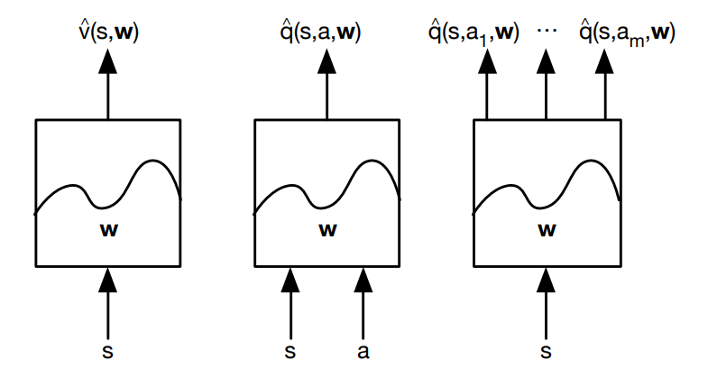
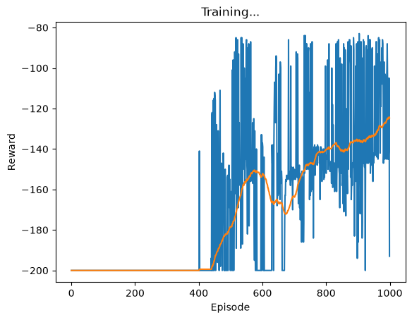

En este capítulo aprenderemos cómo escalar RL hacia problemas en el mundo real y cómo resolverlos, es decir daremos un vistazo más realista a cómo se aplican estos algoritmos en la época actual, e incluso veremos un algoritmo que en su momento fue el estado del arte.

## Introducción

El aprendizaje por refuerzo puede ser usado para resolver problemas que suelen tener MDPs de gran cantidad de estados que resolver de otra manera sería virtualmente imposible, a continuación unos ejemplos:

- Backgammon posee una cantidad de 10²⁰ estados.
- Go posee una cantidad de 10¹⁷⁰ estados.
- Pilotear un helicóptero funciona en un espacio continuo de estados.

La primera pregunta con la cual nos podemos encontrar es ¿Cómo podemos escalar los métodos de predicción y control sin modelo que hemos visto?

Bueno al intentar lograrlo nos trae ciertos problemas como:

- MDPs que tienen muchos estados y no pueden representarse en una tabla o en una base como lo hemos estado haciendo hasta el momento, debido a que la cantidad que ocuparían en memoria no sería eficiente.
- Cuando existen tantos estados resulta muy lento aprender cada uno de estos individualmente.

Hasta ahora hemos representado la función de valor en una tabla donde podíamos elegir qué acción tomar, eso no nos permitiría crecer si es que estuviéramos lidiando con un ambiente que tenga incontables estados y acciones, por otro lado esto también representaría que necesitaríamos una cantidad muy grande de episodios para tener el valor de cada acción para cada estado, lo cual termina siendo inviable en tiempo y en almacenamiento.

Debido a eso buscamos que nuestra función de valor sea capaz de generalizar a través de todos los estados que pudiera encontrar en el ambiente en el que se encuentra, lo cual no nos asegura que el valor que se le asigne a una acción en un estado sea necesariamente el valor óptimo, pero lo que sí representa es una aproximación muy cercana. Para lograrlo nos basamos en una función de valor que se aproxime al valor real, la cual permita que los valores que se estimen para cada acción o estado sea lo más parecido posible a la función de valor real e incluso pueda tener en cuenta el valor de estados que todavía no se han visitado.

Utilizando este principio podemos obtener diferentes tipos de aproximación de función de valor:



- En el primer ejemplo nos muestra cómo se puede obtener el valor de un estado, al introducirlo dentro de nuestro aproximador de función.
- En el segundo ejemplo se puede observar que al introducir un estado y qué acción estaríamos dispuestos a tomar, la función nos retornaría qué tanto valor nos daría tomar dicha acción.
- En el último caso, dado el estado donde nos encontramos podríamos determinar el valor para cada una de las acciones que podemos tomar desde dicho estado.

Dado que estamos buscando cómo aproximar nuestra función puede existir muchas alternativas, entre ellas las más usadas son:

- Combinación lineal de Features.
- Red Neuronal.
- Árboles de decisión, etc.

¿Si hay tantas opciones entonces cuál deberíamos elegir? En este caso debemos centrarnos en aproximadores de función que sean **diferenciables** ya que conocemos hacia dónde se va a dirigir la gradiente de nuestra función debido a que tenemos la recompensa real de cada acción para cada estado (que es lo que se experimenta en cada episodio).

## Métodos incrementales

Revisaremos algunos métodos para actualizar incrementalmente nuestra función de valor, antes de esto, por motivos de practicidad vamos a considerar que tenemos el valor real de la función de valor y queremos llegar a aprenderla con alguno de los métodos presentados a continuación.

### Aproximación de Función de Valor con Stochastic Gradient Descent

[Gradient Descent](https://turing.iimas.unam.mx/~ivanvladimir/posts/gradient_descent/) busca minimizar el [MSE](https://es.wikipedia.org/wiki/Error_cuadr%C3%A1tico_medio) sobre el valor que se aproxima en la función y el valor verdadero.

Aquí J(w) es el error cuadrático medio entre el valor verdadero y el aproximado:

$$
J(\mathbf{w}) = \mathbb{E}_\pi \left[ \left( v_\pi(S) - \hat{v}(S, \mathbf{w}) \right)^2 \right]
$$

La gradiente de J(w) se define como:

<!-- antes una imagen: img-02.png -->
$$
\nabla_{\mathbf{w}} J(\mathbf{w}) =
\begin{pmatrix}
\dfrac{\partial J(\mathbf{w})}{\partial \mathbf{w}_1} \\
\vdots \\
\dfrac{\partial J(\mathbf{w})}{\partial \mathbf{w}_n}
\end{pmatrix}
$$

Para encontrar el mínimo local de J(w) se debe ajustar en dirección de la gradiente:

<!-- antes una imagen: img-03.png -->
$$
\Delta \mathbf{w} = -\frac{1}{2} \alpha \nabla_{\mathbf{w}} J(\mathbf{w})
$$

Donde α representa con qué magnitud nos moveremos en dicha dirección. Para esto tomaremos una muestra aleatoria sobre una acción dado que nos encontramos en un estado, y la compararemos con el valor verdadero, utilizaremos gradient descent para decidir en qué dirección y con qué magnitud vamos a corregir nuestro error, entonces con esto logramos acercarnos cada vez más a la función verdadera basado en los resultados que tenemos al interactuar directamente con el ambiente.

### Aproximación de Función de Valor Lineal

Un método para aproximar la función de valor es el lineal, está basado en una representación del estado donde nos encontramos, esto se puede realizar por medio de un Vector de Características (Feature Vector) el cual podría estar representado por la configuración actual de un tablero de ajedrez, las tendencias en el mercado de valores, etc. Esta representación termina siendo fundamental debido a que si captura correctamente el ambiente en el que se encuentra hará el problema mucho más fácil de resolver.

¿Cómo podemos utilizar ese vector de características? La forma más práctica es formando una combinación lineal de cada uno de sus valores, esto nos permitirá estimar el valor para cada caso utilizando la suma ponderada de cada una de las características que recibirá nuestra función.

<!-- antes una imagen: img-04.png -->
$$
\hat{v}(S, \mathbf{w}) = \mathbf{x}(S)^\top \mathbf{w} = \sum_{j=1}^{n} \mathbf{x}_j(S) \mathbf{w}_j
$$

Para actualizar nuestros pesos se seguiría la siguiente regla, básicamente veremos qué tanto se asemeja nuestro resultado a la realidad y nos moveremos ligeramente con magnitud de α hacia esa dirección:

<!-- antes una imagen: img-05.png -->
$$
\Delta \mathbf{w} = \alpha \left( v_\pi(S) - \hat{v}(S, \mathbf{w}) \right) \mathbf{x}(S)
$$

### Algoritmos de predicción incremental

Hasta ahora se ha asumido que tenemos la capacidad de ver la verdadera función de valor, como una especie de “oráculo”, pero esto no ocurre en la realidad. En la práctica podemos encontrar valores que nos permiten estimar la función directamente desde la experiencia que obtenemos en el ambiente y veremos que las técnicas que hemos venido leyendo también pueden funcionar para este caso.

**Monte-Carlo**

<!-- antes una imagen: img-06.png -->
$$
\begin{aligned}
\Delta \mathbf{w} &= \alpha \left( {\color{red} G_t} - \hat{v}(S_t, \mathbf{w}) \right) \nabla_{\mathbf{w}} \hat{v}(S_t, \mathbf{w}) \\
&= \alpha \left( G_t - \hat{v}(S_t, \mathbf{w}) \right) \mathbf{x}(S_t)
\end{aligned}
$$

Como podemos observar se va a remplazar el valor “correcto” que poseíamos antes por el retorno total de un episodio, esto funcionará como un objetivo un poco ruidoso, que lentamente, dado que cada actualización se dará al fin de un episodio, nos llevará a la verdadera función de valor.

En pocas palabras utilizaremos la información de cada episodio como datos de entrenamiento, como si fuera entrenamiento supervisado.

**TD(0):**

<!-- antes una imagen: img-07.png -->
$$
\Delta \mathbf{w} = \alpha \left( {\color{red} R + \gamma \hat{v}(S', \mathbf{w})} - \hat{v}(S, \mathbf{w}) \right) \nabla_{\mathbf{w}} \hat{v}(S, \mathbf{w})
$$

**TD(**λ**):**

<!-- antes una imagen: img-08.png -->
$$
\Delta \mathbf{w} = \alpha \left( {\color{red} G_t^\lambda} - \hat{v}(S_t, \mathbf{w}) \right) \nabla_{\mathbf{w}} \hat{v}(S_t, \mathbf{w})
$$

Para el caso de TD estimará un valor sesgado, esto se da porque se le pide a la propia función que estime cuál será la recompensa total que recibiremos hasta el final de la trayectoria, eso nos puede generar un error de lo que nuestra función creía era correcto y lo que realmente pasa en el ambiente, esto puede traer consecuencias negativas, como que no necesariamente converja en la función de valor real.

### Control con Aproximación de Valor

Esta vez como control utilizaremos una evaluación de política se basará en utilizar el aproximador de función de valor que diseñamos y la cual nos ayudará a encontrar, luego de algunas iteraciones la función de valor más indicada dado los parámetros que ingresamos. En pocas palabras utilizaremos el mismo concepto que hemos revisado en este post, con la excepción de que en vez de centrarnos en V(s) nos centraremos en Q(s,a), pero utilizaremos exactamente los mismos conceptos que revisamos con Monte-Carlo y TD.

## Métodos de Batch

Hasta ahora hemos visto métodos para actualizar nuestra función de valor luego de cada experiencia, pero esto no termina siendo eficiente debido a que al actualizar nuestra función con la experiencia que acaba de desarrollar nuestro agente la solemos desechar y continuar con una siguiente interacción con el ambiente, esto genera que el uso de los datos no sea eficiente, ya que cada experiencia solo se termina usando una vez y no permite que el agente encuentre realmente **la mejor función de valor para todos los episodios**, en este caso un Batch representaría a un conjunto de experiencias del agente.

### Predicción basada en mínimos cuadrados

Podemos definir nuestros datos de entrenamiento de la misma manera que lo hemos hecho, es decir un par entre estado y valor y mejoraremos los valores de nuestra función al reducir la [suma del error cuadrático](https://es.wikipedia.org/wiki/M%C3%ADnimos_cuadrados) entre lo que predice nuestra función y (para ejemplos prácticos) la función de valor verdadera, dicha función puede ser remplazada por el valor que obtenemos siguiendo Monte-Carlo o TD. La función de mínimos cuadrados se define con la siguiente fórmula.

<!-- antes una imagen: img-09.png -->
$$
LS(\mathbf{w}) = \sum_{t=1}^{T} \left( v_t^\pi - \hat{v}(s_t, \mathbf{w}) \right)^2
$$

### **Experience Replay**

Para hacer un uso correcto de las muestras que obtendremos en la interacción con el ambiente utilizaremos la técnica llamada **experience replay**, la cual consiste en que cada interacción que se dé con el ambiente y recompensa que nos otorgue quedará registrada dentro de una estructura de datos, luego se elegirá aleatoriamente un número de “experiencias” las cuales utilizaremos para entrenar nuestro algoritmo, de esta manera se puede romper la correlación entre los datos y generar una función mucho más estable. Se entrenará el algoritmo una y otra vez hasta que converja a la solución de mínimos cuadrados (con una red neuronal no hay garantía de que sea el mínimo global).

## Implementación

A continuación comparto una implementación de aproximación de valor utilizando una red neuronal, el código también se puede encontrar [aquí](https://github.com/miguelsilva15/Blog-AprendizajePorRefuerzo/blob/master/RL-7-FuncionDeAproximacionDeValor/Aproximaci%C3%B3n%20de%20Valor%20-%20Deep%20Q%20Network.ipynb).

```python
import gymnasium as gym #ambiente de prueba
import math 
import torch
import random

import numpy as np
import torch.nn as nn
import torch.nn.functional as F
import torch.optim as optim
import matplotlib.pyplot as plt

from IPython import display
from itertools import count
from collections import namedtuple


%matplotlib inline

# guardamos el comportamiento para que sea replicable
RANDOM_SEED = 666
torch.manual_seed(RANDOM_SEED)
random.seed(RANDOM_SEED)
np.random.seed(RANDOM_SEED)
```

```python
# arquitectura de la red neuronal
class Net(nn.Module):
    def __init__(self):
        super(Net, self).__init__()
        self.fc1 = nn.Linear(2, 128)
        self.fc2 = nn.Linear(128, 3)

    def forward(self, x):
        x = F.relu(self.fc1(x))
        x = self.fc2(x)
        return x
```

```python
# ambiente que utilizaremos
# la documentación del ambiente https://gymnasium.farama.org/environments/classic_control/mountain_car/
env = gym.make('MountainCar-v0')
env.reset(seed=RANDOM_SEED)
env.action_space.seed(RANDOM_SEED)

# la posición va de -1.2 a 0.6 y la velocidad de -0.07 a 0.07: llevamos las dos a la escala [-1, 1]
# para que la red "vea" la velocidad tanto como la posición.
minimo, maximo = env.observation_space.low, env.observation_space.high

def escalar(observacion):
    observacion = (observacion - (minimo + maximo) / 2) / ((maximo - minimo) / 2)
    return torch.from_numpy(observacion.reshape((-1, 2)).copy()).float()
```

```python
# creamos una red que contendrá la politica y 
# otra red que servirá como target, las dos 
# son iguales en arquitectura pero varían en la velocidad con que serán actualizadas.
# la red policy será actualizada en cada paso, la otra red empieza como una copia
# y en cada paso se acerca solo un poco a la red policy (ver TAU).
policy_net = Net()
target_net = Net()
_ = target_net.load_state_dict(policy_net.state_dict())
```

```python
Transition = namedtuple('Transition',
                        ('state', 'action', 'next_state', 'reward'))


class ReplayMemory(object):
    '''Esta es la estructura donde se almacenará los pasos
       que se ejecuten en el ambiente.'''
    def __init__(self, capacity):
        self.capacity = capacity
        self.memory = []
        self.position = 0

    def push(self, *args):
        if len(self.memory) < self.capacity:
            self.memory.append(None)
        self.memory[self.position] = Transition(*args)
        self.position = (self.position + 1) % self.capacity

    def sample(self, batch_size):
        return random.sample(self.memory, batch_size)

    def __len__(self):
        return len(self.memory)
```

```python
learning_rate = 1e-3
optimizer = optim.Adam(policy_net.parameters(), lr=learning_rate)
```

```python
steps_done = 0
n_actions = 3
episode_durations = []

BATCH_SIZE = 2048
GAMMA = 0.995
EPS_START = 0.99
EPS_END = 0.02
EPS_DECAY = 8000
TAU = 0.005
```

```python
#capacidad de la memoria
memory = ReplayMemory(20000)
```

```python
def seleccionar_accion(state):
    global steps_done
    sample = random.random()
    eps_threshold = EPS_END + (EPS_START - EPS_END) * \
        math.exp(-1. * steps_done / EPS_DECAY)
    steps_done += 1
    if sample > eps_threshold:
        with torch.no_grad():
            return policy_net(state).max(1)[1].view(1, 1)
    else:
        return torch.tensor([[random.randrange(n_actions)]], dtype=torch.long)
```

```python
def optimize_model():
    if len(memory) < BATCH_SIZE:
        return
    transitions = memory.sample(BATCH_SIZE)
    batch = Transition(*zip(*transitions))
    non_final_mask = torch.tensor(tuple(map(lambda s: s is not None,
                                          batch.next_state)),dtype=torch.bool)
    non_final_next_states = torch.cat([s for s in batch.next_state
                                                if s is not None])
    state_batch = torch.cat(batch.state)
    action_batch = torch.cat(batch.action)
    reward_batch = torch.cat(batch.reward)

    state_action_values = policy_net(state_batch).gather(1, action_batch)

    # Calcula V(s_{t+1}) para todos los estados siguientes.
    # mayor detalle de la implementación puede ser encontrado en:
    # https://pytorch.org/tutorials/intermediate/reinforcement_q_learning.html
    next_state_values = torch.zeros(BATCH_SIZE)
    next_state_values[non_final_mask] = target_net(non_final_next_states).max(1)[0].detach()
    expected_state_action_values = (next_state_values * GAMMA) + reward_batch

    loss = F.mse_loss(state_action_values, expected_state_action_values.unsqueeze(1))

    optimizer.zero_grad()
    loss.backward()
    for param in policy_net.parameters():
        param.grad.data.clamp_(-1, 1)
    optimizer.step()
    return loss.item()
```

```python
def plot_durations():
    plt.figure(2)
    plt.clf()
    durations_t = torch.tensor(reward_t, dtype=torch.float)
    plt.title('Training...')
    plt.xlabel('Episode')
    plt.ylabel('Reward')
    plt.plot(durations_t.numpy())
    # Se toma el promedio de la duración de los ultimos 100 episodios y se grafica.
    if len(durations_t) >= 100:
        means = durations_t.unfold(0, 100, 1).mean(1).view(-1)
        means = torch.cat((torch.repeat_interleave(means[0], 99), means))
        plt.plot(means.numpy())
    plt.pause(0.01) 
    display.clear_output(wait=True)
```

```python
num_episodes = 1000
loss_t = []
reward_t = []
loss_ = False
for i_episode in range(num_episodes):
    state, _ = env.reset()
    state = escalar(state)
    reward_acc = 0
    for t in count():
        accion = seleccionar_accion(state)
        observacion, reward, terminado, truncado, _ = env.step(accion.item())
        done = terminado or truncado
        # si llegó a la bandera no hay estado siguiente: ese final vale 0.
        next_state = None if terminado else escalar(observacion)
        reward = torch.tensor([reward])
        reward_acc += reward.item()
        memory.push(state, accion, next_state, reward)
        state = next_state
        loss_ = optimize_model()
        # la red target sigue a la red policy un poco en cada paso.
        for target_param, policy_param in zip(target_net.parameters(), policy_net.parameters()):
            target_param.data.copy_(TAU * policy_param.data + (1 - TAU) * target_param.data)
        if done:
            episode_durations.append(t + 1)
            loss_t.append(loss_)
            reward_t.append(reward_acc)
            plot_durations()
            break
```



Actualicé este código en octubre de 2026 (Python 3.14, Gymnasium 1.4.0, PyTorch 2.14). Al volver a ejecutar la versión de 2020, el carro casi nunca llegaba a la bandera, así que hice cinco cambios: cuando llega a la bandera no hay estado siguiente y ese final vale 0; la red target se acerca un poco a la red policy en cada paso en vez de copiarla de golpe; la tasa de aprendizaje bajó de 0.05 a 0.001; la exploración baja más despacio y hasta el 2 %; y la posición y la velocidad entran a la red en la misma escala. En una prueba con 2000 episodios el mejor promedio llegó cerca del episodio 1000 y luego bajó poco a poco, por eso aquí entreno 1000.

Gracias por haberme seguido hasta aquí, si tienes alguna duda (o algo en lo que crees que podría mejorar) no dudes en hablarme.

## Referencias

- [UCL Course on RL Lecture 6: Value Function Approximation](https://davidstarsilver.wordpress.com/wp-content/uploads/2025/04/lecture-6-value-function-approximation-.pdf)
- [DQN Implementation in PyTorch](https://pytorch.org/tutorials/intermediate/reinforcement_q_learning.html)
- [Richard Sutton’s Intro to Reinforcement Learning](http://incompleteideas.net/book/RLbook2018.pdf)
