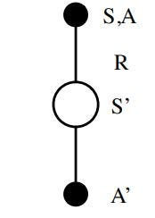
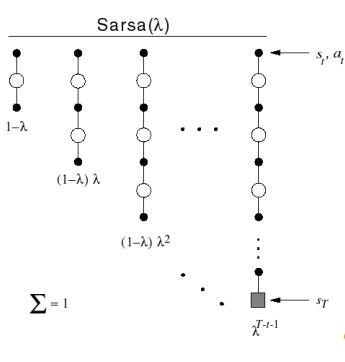
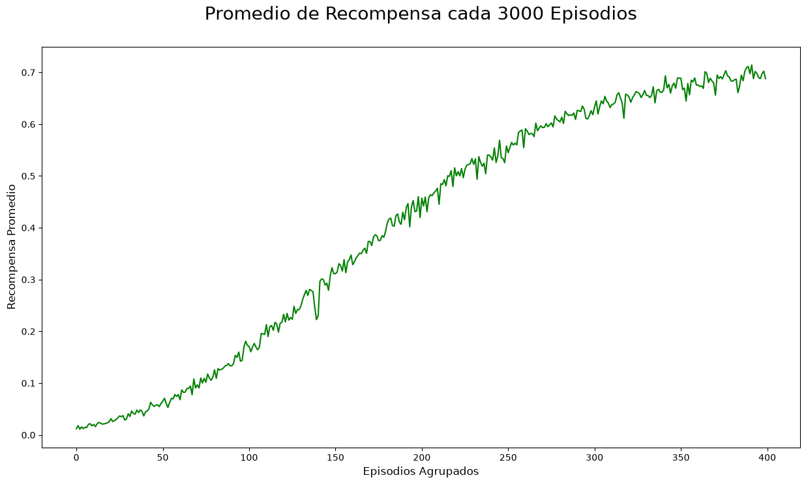
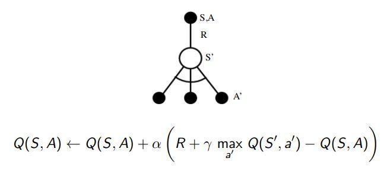
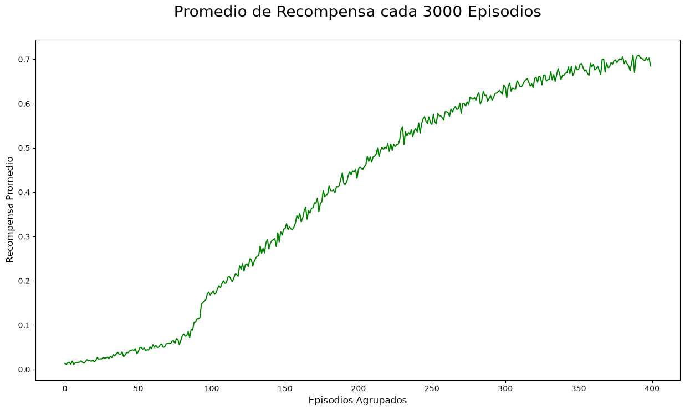
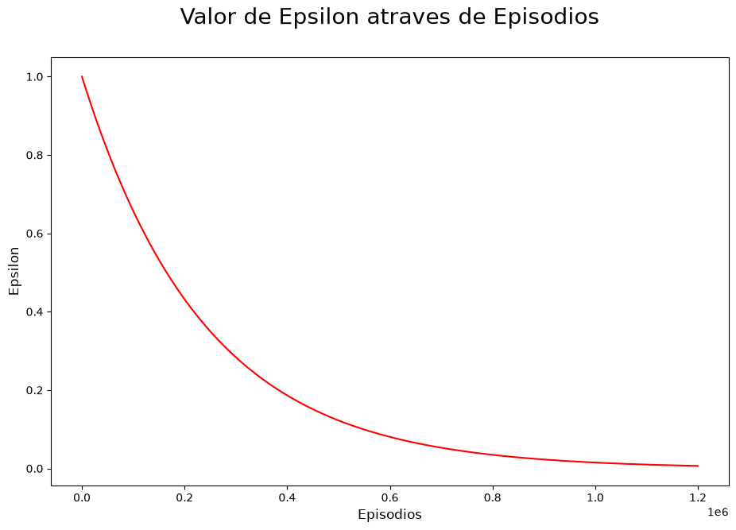
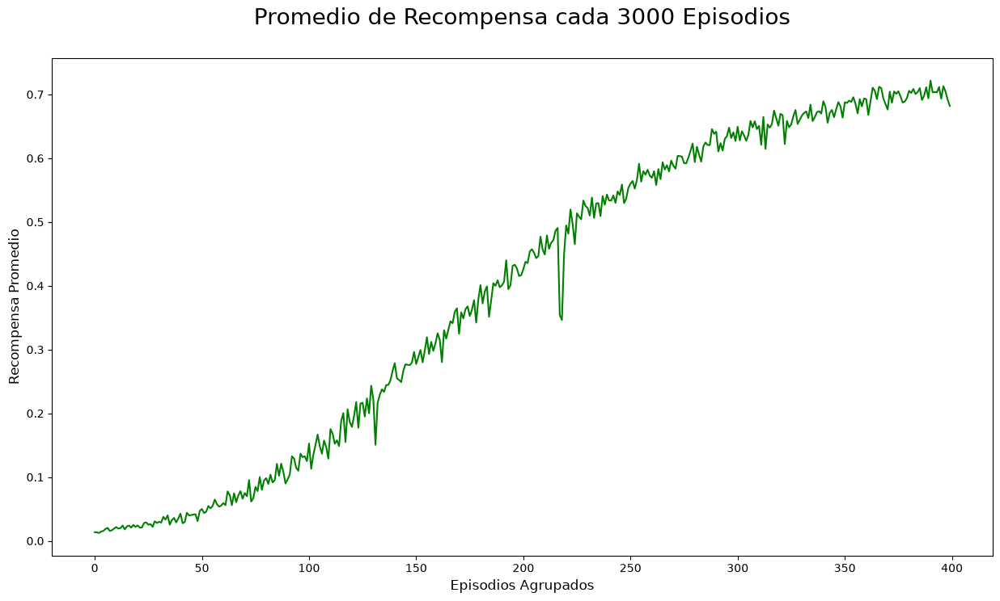

En este capítulo nos centraremos en entender cómo un agente sin experiencia previa en un ambiente desconocido (el cual puede o no tener final) decide qué acciones debe desempeñar para maximizar la recompensa, para lograr esto nos basaremos en lo visto en el capítulo anterior, el cual trató de cómo estimar una función de valor para un MDP desconocido, en este caso buscaremos optimizar esa función utilizando técnicas que hemos visto antes y algunas nuevas, para comenzar revisaremos qué tipos de políticas podemos utilizar para esta clase de problemas.

## Tipos de política

### Aprendizaje usando política

Se sigue la política π, y mientras esto se hace también se le evalúa realizando muestras sobre ellas.

### Aprendizaje sin utilizar la política

Se aprende de una política π utilizando muestras realizadas por otro u otros agentes, el ejemplo más entendible sería quizás observar el ejemplo de otra persona (o pedirle consejo a alguien para tomar una decisión) y guiarse de eso para saber qué tan bueno sería tomar una decisión.

## Iteración de Política Generalizada

Como habíamos visto en capítulos anteriores la iteración de política está basada en una función que evalúe la política π y otra que se encargue de mejorarla, así sucesivamente hasta encontrar la política que nos dé la mejor recompensa, la cual sería nuestra política final. Por otro lado, si quisiéramos iniciar explorando este ambiente sin tener conocimientos previos de sus estados, ¿Cómo lo haríamos?

Para esto debemos tener claro que debemos elegir dos algoritmos, uno para la evaluación y otro para el mejoramiento de política, para evaluación podríamos utilizar un algoritmo que ya venimos conociendo un tiempo atrás, **Monte-Carlo**, como paso inicial, y para el caso del mejoramiento podríamos utilizar mejoramiento voraz (consiste en siempre elegir los casos que nos aseguran la mejor recompensa), de esta manera Monte-Carlo podría darnos los valores para cada acción y cada estado que visitamos, a la vez que el mejoramiento voraz nos daría una dirección en la cual deberíamos seguir dirigiéndonos para mejorar esta política, para que esto funcione, el mejoramiento voraz necesita un modelo de MDP.

Como vamos a centrarnos en encontrar el mejor valor para cada acción nuestra política tiene que estar basada en las posibles acciones que se pueden tomar desde un estado *s*, en otras palabras, en este nuevo escenario nos centraríamos en usar la política π para encontrar el valor de cada acción que se tomaría en cada estado *s*, y con esto elegir la acción que genere mayor valor a través de cada estado, generando una nueva política π.

La desventaja de utilizar este modelo es que se vería limitado por el mejoramiento voraz debido a que siempre tomaría la elección que nos diera el mayor valor inmediato, sin contemplar opciones que podrían ser más provechosas a largo plazo, en otras palabras, tener opción de mantener:

- Exploración continua.
- Todas las acciones han sido probadas con probabilidades mayores a cero.

### Exploración ε-Greedy

Es por esto que nace el concepto de exploración ε-greedy, la cual nos permite tener una probabilidad de 1 — ε de escoger la mejor acción para nuestra política y una probabilidad de ε para escoger una acción totalmente aleatoria, con este método tendremos la posibilidad de visitar estados que no serían posibles de visitar escogiendo siempre el mejor estado, y por otro lado esto nos asegura como mínimo tener una solución igual de buena que la política actual, si es que no mejor.

## ¿Cómo podemos seguir mejorando nuestro modelo?

Ahora que ya hemos encontrado un método que nos ayuda a explorar el ambiente y en general a tener una mejor política, deberíamos buscar cómo mejorar la evaluación de la misma, al utilizar Monte-Carlo nos asegura llegar al mejor resultado pero no necesariamente por un proceso veloz, dicho esto haría falta elegir una forma más eficiente de evaluar dichas políticas, quizá podríamos comenzar por no esperar hasta recorrer cierto número de episodios para evaluar nuestra política, en cambio bastaría con evaluarla al final de un solo episodio, lo cual daría suficiente información para guiarnos hacia una ligeramente mejor política π.

Sin embargo debemos encontrar un balance entre el tiempo que nos tomará encontrar la mejor política y la cantidad de acciones aleatorias que tomaremos, es por esto que nace el concepto de GLIE.

## GLIE

GLIE (Greedy in the Limit with Infinite Exploration) parte de la necesidad de limitar la exploración luego de que se hayan cumplido sus dos pilares fundamentales:

- Todas las acciones por cada estado han sido exploradas una infinidad de veces.
- La política al final convergerá en una política voraz.

Una forma de llegar a eso es por medio de ε-greedy, la cual se podría convertir en una política voraz si ε tiende a 0 con el paso del tiempo, aquí dejo una [implementación en Python](https://github.com/miguelsilva15/Blog-AprendizajePorRefuerzo/blob/master/RL-6-ControlSinModelo/GLIE%20Monte-Carlo%20Control.ipynb) para que veas detalladamente cómo funciona.

Una pregunta que nacería naturalmente con la experimentación sería la siguiente, ¿Cómo podríamos actualizar nuestra política si estamos hablando de un ambiente continuo (Online)? Qué acción deberíamos tomar si es que no podemos esperar hasta el final del episodio para actualizar nuestra política, por este motivo nos centraremos en una herramienta que habíamos visto en el capítulo pasado, **TD Learning** como método de evaluación de política, este algoritmo también posee otros beneficios aparte de ser un entrenamiento “Online”, como disminuir la varianza y actualizar nuestra política aunque las secuencias no sean completadas del todo.

## SARSA

Al usar TD Learning como método de evaluación y ε-greedy como método de actualización llegamos al algoritmo SARSA, el cual significa:



Dicho algoritmo representa un patrón de actualización para nuestra política explicado por la siguiente fórmula:

<!-- antes una imagen: img-03.jpeg -->
$$
Q(S, A) \leftarrow Q(S, A) + \alpha \left( R + \gamma Q(S', A') - Q(S, A) \right)
$$

De esta manera se actualiza nuestro valor para cada par estado-acción dependiendo de las acciones que se podrán tomar desde ese punto.

SARSA se centra en actualizar nuestro valor inicial para el estado *s* y la acción *a* sumándole [TD Target](../predicciones-sin-modelo/index.qmd#cómo-funciona-el-td) menos nuestro valor de ese par original todo esto multiplicado por un valor α, que representa el impacto con el cual se actualizará los valores, como quedó claro esto se va a actualizar cada vez que se tome una acción en nuestro ambiente, eso significa que si volvemos a caer en un estado que ya ha sido visitado, vamos a tener un valor actualizado de ese estado con la última información que pudimos recabar.

## SARSA λ

SARSA λ nos da lo mejor de los dos algoritmos que hemos visto anteriormente en este capítulo, SARSA λ nos permite variar qué tanto deseamos “recordar” (al igual que TD λ) los estados y acciones que hemos visitado, nos ayuda a decidir en qué medida valoramos estas acciones y estados ejecutados en el mismo episodio en pasos anteriores con respecto a nuestra actualización de valores, a continuación se muestra gráficamente cómo el valor de los estados visitados en el pasado se ven afectados por la constante λ, que en cada paso se multiplicará de nuevo por el mismo factor, para así decrecer el impacto de ese paso en el tiempo.



De esta manera se promedian todos los pasos realizados desde el inicio del episodio hasta ese momento en el tiempo para actualizar los valores de los estados y acciones visitados.\
En el algoritmo también tendremos en cuenta [rastros de elegibilidad](../predicciones-sin-modelo/index.qmd#rastros-de-elegibilidad), en este caso representados por Et(*s, a*). Al ejecutarse la actualización tendremos en cuenta el TD-Error representado con δ, siempre todo multiplicado por un valor de α que representa la magnitud de actualización de nuestros valores como se muestra en la siguiente fórmula:

<!-- antes una imagen: img-05.jpeg -->
$$
E_t(s, a) = \gamma \lambda E_{t-1}(s, a) + \mathbf{1}(S_t = s, A_t = a)
$$

<!-- antes una imagen: img-06.jpeg -->
$$
\begin{aligned}
\delta_t &= R_{t+1} + \gamma Q(S_{t+1}, A_{t+1}) - Q(S_t, A_t) \\
Q(s, a) &\leftarrow Q(s, a) + \alpha \delta_t E_t(s, a)
\end{aligned}
$$

A continuación una [implementación de SARSA λ en Python](https://github.com/miguelsilva15/Blog-AprendizajePorRefuerzo/blob/master/RL-6-ControlSinModelo/SARSA%20Lambda.ipynb) para que el concepto quede más claro.

:::: {.callout-note collapse="true"}
## Código: SARSA λ

Usa la función `e_greedy` de `utils.py`, que está en [Implementación](#implementación). El notebook completo está en [GitHub](https://github.com/miguelsilva15/Blog-AprendizajePorRefuerzo/blob/master/RL-6-ControlSinModelo/SARSA%20Lambda.ipynb).

```python
import gymnasium as gym # para elegir el ambiente en el cual entrenaremos el agente.
import sys

import pandas as pd # para disponer de la data de forma mas organizada.
import matplotlib.pyplot as plt # para mostrar gráficos.
import numpy as np #para el procesamiento de números.

np.random.seed(666)

%matplotlib inline

from collections import defaultdict #utilizaremos un defaultdict como base
# en la cual guardaremos el valor que tendrá cada una de nuestras acciones.
from utils import e_greedy
```

```python
env = gym.make('FrozenLake-v1') #este es el ambiente que utilizaremos,
# puedes buscar como funciona en la documentación.
_ = env.reset(seed=666) #fija la semilla del ambiente, para poder repetir el resultado
```

```python
numero_de_acciones = env.action_space.n
Q = defaultdict(lambda: np.zeros(numero_de_acciones)) #se define nuestra base como un diccionario anidado con cada acción 
#que podría tomar el agente.
decay = 0.0000042
decay = 1 - decay #este valor será por el cual decaerá nuestro epsilon en cada episodio. 
alpha = 0.0005 #nuestro valor de "media movil" se verá afectado por esta variable. 
lambd = 0.9 #variable lambda de TD(lambda).
gamma = 0.95 #variable por la cual verá reducido la elegibilidad de cada estado.

episode = 0
total_reward = 0
eps = epsilon = 1 # valor de epsilon inicial
eps_list = list() #variable que almacenará los valores de epsilon.
reward_list = [] #variable que almacenará los valores de recompensa.
```

```python
for numb_iter in range(1, 1200001):
    estado_anterior, _ = env.reset()
    epsilon= eps*decay**episode  
    reward_list.append(total_reward)
    total_reward = 0
    episode += 1
    actions_prob = e_greedy(Q, epsilon, numero_de_acciones, estado_anterior) #variable que almacenará la probabilidad de realizar cada acción. 
    selected_next_action = np.argmax(np.random.multinomial(1, actions_prob)) #se elige la acción.
    counter_state_actions = set() #esta variable almacenará cada que accion se realice por cada episodio.
    elegibilidad = defaultdict(lambda: np.zeros(numero_de_acciones)) 
    while True:   
        for ob, ac in counter_state_actions:
            elegibilidad[ob][ac]  *= lambd* gamma 
        elegibilidad[estado_anterior][selected_next_action] += 1.0
        obs, temporal_reward, terminado, truncado, _ = env.step(selected_next_action)
        final = terminado or truncado #el episodio acaba por el ambiente (terminado) o por el límite de pasos (truncado)
        counter_state_actions.add((estado_anterior, selected_next_action))
        selected_action = selected_next_action
        actions_prob = e_greedy(Q, epsilon, numero_de_acciones, obs) #variable que almacenará la probabilidad de realizar cada acción. 
        selected_next_action = np.argmax(np.random.multinomial(1, actions_prob)) #se elige la acción.   
        td_error = temporal_reward + gamma * Q[obs][selected_next_action] - Q[estado_anterior][selected_action]
        for ob, ac in counter_state_actions:
            Q[ob][ac] += alpha * td_error * elegibilidad[ob][ac]
        estado_anterior = obs
        total_reward += temporal_reward
        if final:
            if episode % 100000 == 0:
                print(f'Número de Episodios Realizados: {episode}')           
            eps_list.append(epsilon)
            break
```

::: {.nb-output}
```
Número de Episodios Realizados: 100000
Número de Episodios Realizados: 200000
Número de Episodios Realizados: 300000
Número de Episodios Realizados: 400000
Número de Episodios Realizados: 500000
Número de Episodios Realizados: 600000
Número de Episodios Realizados: 700000
Número de Episodios Realizados: 800000
Número de Episodios Realizados: 900000
Número de Episodios Realizados: 1000000
Número de Episodios Realizados: 1100000
Número de Episodios Realizados: 1200000
```
:::

```python
plt.figure(figsize=(11,7)) 
plt.title('Valor de Epsilon atraves de Episodios', fontsize=20, pad=30)
plt.xlabel('Episodios', fontsize=12)
plt.ylabel('Epsilon', fontsize=12)

plt.plot(eps_list, color='r')
```


```python
df = pd.DataFrame({'Reward': reward_list})
```

```python
plt.figure(figsize=(15,8)) 
plt.title('Promedio de Recompensa cada 3000 Episodios', fontsize=20, pad=30)
plt.xlabel('Episodios Agrupados', fontsize=12)
plt.ylabel('Recompensa Promedio', fontsize=12)
plt.plot(df.groupby(df.index //3000)['Reward'].mean(), color='g')
```



```python
Q
```

::: {.nb-output}
```
defaultdict(<function __main__.<lambda>()>,
            {0: array([0.16733262, 0.16103185, 0.16177678, 0.15851396]),
             4: array([0.19578473, 0.14968439, 0.13750081, 0.12255647]),
             8: array([0.14391385, 0.19412623, 0.18207562, 0.25883041]),
             9: array([0.23948054, 0.36279075, 0.27932647, 0.20617548]),
             10: array([0.38405777, 0.33235978, 0.26832376, 0.16180898]),
             11: array([0., 0., 0., 0.]),
             5: array([0., 0., 0., 0.]),
             1: array([0.08180946, 0.08496883, 0.07703245, 0.14855739]),
             12: array([0., 0., 0., 0.]),
             14: array([0.51119489, 0.71401638, 0.68548844, 0.61231512]),
             13: array([0.25990588, 0.37702804, 0.49237952, 0.34040207]),
             2: array([0.14554138, 0.12068572, 0.1232465 , 0.10899049]),
             6: array([0.156147  , 0.11502148, 0.16282666, 0.04060761]),
             3: array([0.03554855, 0.03659547, 0.03113266, 0.11893593]),
             7: array([0., 0., 0., 0.]),
             15: array([0., 0., 0., 0.])})
```
:::
::::

## Aprendizaje Fuera de Política

Hasta este punto dentro de todos los capítulos solo hemos observado la capacidad de aprender de la misma política que estamos evaluando pero esto no siempre es el caso, es aquí donde nace el concepto de aprendizaje fuera de política el cual se basa en evaluar una política objetivo mientras se sigue otra llamada de comportamiento, un ejemplo de esto sería tener una política exploratoria como política de comportamiento y tener una política objetivo que esté basada en la elección de la acción que nos dé mayor valor, esto nos puede ayudar a balancear el concepto de la **exploración vs explotación** uno de los problemas esenciales dentro del Aprendizaje por Refuerzo. Otro motivo por el cual podría interesarnos es que permite aprender múltiples políticas (teniéndolas como políticas objetivo) mientras se sigue la política de comportamiento.

**Q-Learning**

Es aquí donde nace el concepto de Q-Learning, con la aplicación del concepto de aprendizaje fuera de política hacia algoritmos que permitan disminuir la variación de la misma, como SARSA, el funcionamiento de estos conceptos juntos es el siguiente, se centra en que la política de comportamiento sea la que siempre elija qué acción tomar y a su vez se contempla qué valor puede tener una siguiente acción tomada de la política objetivo, de esta manera nos ayudaría a medir mejor el valor de la acción actual tomando en cuenta ambas políticas.



Dicho modelo tiene como objetivo mejorar la política objetivo y de comportamiento, y para lograr esto Q-Learning utiliza una política voraz como objetivo (para tener el valor de la mejor acción posible) y una política de comportamiento ε-greedy (para que tengamos la totalidad de estados y acciones explorados), esto nos lleva, por medio de la ecuación de Bellman a encontrar la política óptima.

:::: {.callout-note collapse="true"}
## Código: Q-Learning

Usa la función `e_greedy` de `utils.py`, que está en [Implementación](#implementación). El notebook completo está en [GitHub](https://github.com/miguelsilva15/Blog-AprendizajePorRefuerzo/blob/master/RL-6-ControlSinModelo/Q-Learning.ipynb).

```python
import gymnasium as gym # para elegir el ambiente en el cual entrenaremos el agente.
import sys

import pandas as pd # para disponer de la data de forma mas organizada.
import matplotlib.pyplot as plt # para mostrar gráficos.
import numpy as np #para el procesamiento de números.

np.random.seed(666)

%matplotlib inline

from collections import defaultdict #utilizaremos un defaultdict como base
# en la cual guardaremos el valor que tendrá cada una de nuestras acciones.
from utils import e_greedy
```

```python
env = gym.make('FrozenLake-v1') #este es el ambiente que utilizaremos,
# puedes buscar como funciona en la documentación.
_ = env.reset(seed=666) #fija la semilla del ambiente, para poder repetir el resultado
```

```python
numero_de_acciones = env.action_space.n
Q = defaultdict(lambda: np.zeros(numero_de_acciones)) #se define nuestra base como un diccionario anidado con cada acción 
#que podría tomar el agente.
decay = 0.0000042
decay = 1 - decay #este valor será por el cual decaerá nuestro epsilon en cada episodio. 
alpha = 0.0005 #nuestro valor de "media movil" se verá afectado por esta variable. 
gamma = 0.95 #factor de descuento de las recompensas futuras.

episode = 0
total_reward = 0
eps = epsilon = 1 # valor de epsilon inicial
eps_list = list() #variable que almacenará los valores de epsilon.
reward_list = [] #variable que almacenará los valores de recompensa.
```

```python
for numb_iter in range(1, 1200000):
    estado_anterior, _ = env.reset()
    epsilon= eps*decay**episode  
    reward_list.append(total_reward)
    total_reward = 0
    episode += 1
    actions_prob = e_greedy(Q, epsilon, numero_de_acciones, estado_anterior) #variable que almacenará la probabilidad de realizar cada acción. 
    selected_next_action = np.argmax(np.random.multinomial(1, actions_prob)) #se elige la acción.
    while True:   
        obs, temporal_reward, terminado, truncado, _ = env.step(selected_next_action)
        final = terminado or truncado #el episodio acaba por el ambiente (terminado) o por el límite de pasos (truncado)
        selected_action = selected_next_action
        actions_prob = e_greedy(Q, epsilon, numero_de_acciones, obs) #variable que almacenará la probabilidad de realizar cada acción. 
        selected_next_action = np.argmax(np.random.multinomial(1, actions_prob)) #se elige la acción.   
        #solo se actualiza el valor del par (estado, acción) que se acaba de jugar.
        Q[estado_anterior][selected_action] += alpha * (temporal_reward + gamma * Q[obs][np.argmax(Q[obs])] - Q[estado_anterior][selected_action])
        estado_anterior = obs
        total_reward += temporal_reward
        if final:
            if episode % 100000 == 0:
                print(f'Número de Episodios Realizados: {episode}')           
            eps_list.append(epsilon)
            break
```

::: {.nb-output}
```
Número de Episodios Realizados: 100000
Número de Episodios Realizados: 200000
Número de Episodios Realizados: 300000
Número de Episodios Realizados: 400000
Número de Episodios Realizados: 500000
Número de Episodios Realizados: 600000
Número de Episodios Realizados: 700000
Número de Episodios Realizados: 800000
Número de Episodios Realizados: 900000
Número de Episodios Realizados: 1000000
Número de Episodios Realizados: 1100000
```
:::

```python
plt.figure(figsize=(11,7)) 
plt.title('Valor de Epsilon atraves de Episodios', fontsize=20, pad=30)
plt.xlabel('Episodios', fontsize=12)
plt.ylabel('Epsilon', fontsize=12)

plt.plot(eps_list, color='r')
```


```python
df = pd.DataFrame({'Reward': reward_list})
```

```python
plt.figure(figsize=(15,8)) 
plt.title('Promedio de Recompensa cada 3000 Episodios', fontsize=20, pad=30)
plt.xlabel('Episodios Agrupados', fontsize=12)
plt.ylabel('Recompensa Promedio', fontsize=12)
plt.plot(df.groupby(df.index //3000)['Reward'].mean(), color='g')
```



```python
Q
```

::: {.nb-output}
```
defaultdict(<function __main__.<lambda>()>,
            {0: array([0.17856144, 0.17272719, 0.17200595, 0.16327648]),
             4: array([0.20632593, 0.15377256, 0.14341815, 0.12079893]),
             8: array([0.15352161, 0.20156184, 0.17962873, 0.26638579]),
             9: array([0.24547571, 0.37216881, 0.28660106, 0.21416926]),
             10: array([0.39754283, 0.34687734, 0.28611501, 0.17309577]),
             11: array([0., 0., 0., 0.]),
             5: array([0., 0., 0., 0.]),
             1: array([0.10618972, 0.10638551, 0.0968513 , 0.15523046]),
             12: array([0., 0., 0., 0.]),
             14: array([0.51967362, 0.71992915, 0.68593507, 0.61697365]),
             13: array([0.28509968, 0.38470453, 0.50802292, 0.34783627]),
             2: array([0.15355193, 0.14461999, 0.14359513, 0.13668374]),
             6: array([0.17064613, 0.1312255 , 0.17391164, 0.04847348]),
             3: array([0.05037522, 0.04821116, 0.03926747, 0.13154451]),
             7: array([0., 0., 0., 0.]),
             15: array([0., 0., 0., 0.])})
```
:::
::::

## Implementación

A continuación comparto una implementación de Monte-Carlo, pero en [**mi repositorio de GitHub tengo implementaciones de Q-Learning y SARSA.**](https://github.com/miguelsilva15/Blog-AprendizajePorRefuerzo/tree/master/RL-6-ControlSinModelo)

::: {.callout-note collapse="true"}
## Código de apoyo: `utils.py`

```python
import numpy as np

def e_greedy(Q, epsilon, nA, observation):
    '''Retorna la mejor acción dada la politica Q, esto 
    siempre con la probabilidad epsilon de elegir una acción
    al azar'''
    A = np.ones(nA) * epsilon / nA
    best_action = np.argmax(Q[observation])
    A[best_action] += (1.0 - epsilon)
    return A
```
:::

```python
import gymnasium as gym # para elegir el ambiente en el cual entrenaremos el agente.
import sys

import pandas as pd # para disponer de la data de forma mas organizada.
import matplotlib.pyplot as plt # para mostrar gráficos.
import numpy as np #para el procesamiento de números.

np.random.seed(777)

%matplotlib inline

from collections import defaultdict #utilizaremos un defaultdict como base
# en la cual guardaremos el valor que tendrá cada una de nuestras acciones. 
from utils import e_greedy
```

```python
env = gym.make('FrozenLake-v1') #este es el ambiente que utilizaremos,
# puedes buscar como funciona en la documentación.
```

```python
numero_de_acciones = env.action_space.n
Q = defaultdict(lambda: np.zeros(numero_de_acciones)) #se define nuestra base como un diccionario anidado con cada acción 
#que podría tomar el agente.


decay = 0.0000042
decay = 1 - decay #este valor será por el cual decaerá nuestro epsilon en cada episodio. 

alpha = 0.01 #nuestro valor de "media movil" se verá afectado por esta variable. 

episode = 0
counter_state_actions = set() #esta variable almacenará cada que accion se realice por cada episodio.
total_reward = 0
constante = epsilon = 1 # valor de epsilon inicial
obs, _ = env.reset(seed=777) #inicia el ambiente (con semilla, para poder repetir el resultado)
eps_list = list() #variable que almacenará los valores de epsilon.
reward_list = [] #variable que almacenará los valores de recompensa.
```

```python
for numb_iter in range(1, 1200001):
    episode += 1
    while True:   
        actions_prob = e_greedy(Q, epsilon, numero_de_acciones, obs) #variable que almacenará la probabilidad de realizar cada acción. 
        selected_action = np.argmax(np.random.multinomial(1, actions_prob)) #se elige la acción de acuerdo a las probabilidades que ocurran.
        counter_state_actions.add((obs, selected_action)) #se agrega la acción y el estado en donde se encuentra  
        obs, temporal_reward, terminado, truncado, _ = env.step(selected_action)
        final = terminado or truncado #el episodio acaba por el ambiente (terminado) o por el límite de pasos (truncado)
        total_reward += temporal_reward
        if final:
            if episode % 100000 == 0:
                print(f'Número de Episodios Realizados: {episode}')         
            for ob, ac in counter_state_actions:
                Q[ob][ac] += alpha* (total_reward - Q[ob][ac]) #se actualiza el valor de cada acción en cada estado que estuvo involucrado.
            eps_list.append(epsilon)
            epsilon= constante*decay**episode #decae epsilon
            obs, _ = env.reset()
            reward_list.append(total_reward)
            total_reward = 0
            counter_state_actions = set()
            break
```

::: {.nb-output}
```
Número de Episodios Realizados: 100000
Número de Episodios Realizados: 200000
Número de Episodios Realizados: 300000
Número de Episodios Realizados: 400000
Número de Episodios Realizados: 500000
Número de Episodios Realizados: 600000
Número de Episodios Realizados: 700000
Número de Episodios Realizados: 800000
Número de Episodios Realizados: 900000
Número de Episodios Realizados: 1000000
Número de Episodios Realizados: 1100000
Número de Episodios Realizados: 1200000
```
:::

```python
plt.figure(figsize=(11,7)) 
plt.title('Valor de Epsilon atraves de Episodios', fontsize=20, pad=30)
plt.xlabel('Episodios', fontsize=12)
plt.ylabel('Epsilon', fontsize=12)
plt.plot(eps_list, color='r')
```



```python
df = pd.DataFrame({'Reward': reward_list})
```

```python
plt.figure(figsize=(15,8)) 
plt.title('Promedio de Recompensa cada 3000 Episodios', fontsize=20, pad=30)
plt.xlabel('Episodios Agrupados', fontsize=12)
plt.ylabel('Recompensa Promedio', fontsize=12)
plt.plot(df.groupby(df.index //3000)['Reward'].mean(), color='g')
```



```python
Q
```

::: {.nb-output}
```
defaultdict(<function __main__.<lambda>()>,
            {0: array([0.64872188, 0.55519318, 0.54045388, 0.57202126]),
             4: array([0.65117279, 0.45329994, 0.36016008, 0.3863543 ]),
             8: array([0.40491151, 0.36500373, 0.42262894, 0.65842282]),
             1: array([0.36167407, 0.29727266, 0.25546344, 0.47366043]),
             2: array([0.31830702, 0.32369242, 0.32672494, 0.45373966]),
             6: array([0.25790535, 0.23705466, 0.33795361, 0.14804296]),
             9: array([0.44831155, 0.66724437, 0.47154336, 0.42305228]),
             10: array([0.60447847, 0.52296887, 0.4014465 , 0.36710678]),
             13: array([0.45479967, 0.60880903, 0.73733508, 0.52526832]),
             14: array([0.71509948, 0.85752314, 0.80282114, 0.78027574]),
             3: array([0.20558106, 0.23756616, 0.25399436, 0.4225149 ])})
```
:::

El notebook completo está en [GitHub](https://github.com/miguelsilva15/Blog-AprendizajePorRefuerzo/blob/master/RL-6-ControlSinModelo/GLIE%20Monte-Carlo%20Control.ipynb). Probado en octubre de 2026 con Python 3.14, Gymnasium 1.4.0 y NumPy 2.5.4.

Esto es todo lo que veremos por este capítulo, espero que les sea de ayuda y cualquier duda por favor escribirme.

¡Muchas gracias!

## Referencias

- [UCL Course on RL Lecture 5: Model-Free Control](https://davidstarsilver.wordpress.com/wp-content/uploads/2025/04/lecture-5-model-free-control-.pdf)
- [Richard Sutton’s Intro to Reinforcement Learning](http://incompleteideas.net/book/RLbook2018.pdf)
