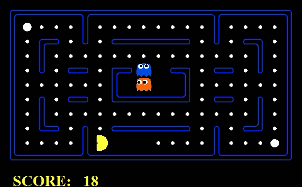
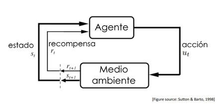

Hola a todos, esta será una serie de posts donde explicaré la teoría detrás del aprendizaje por refuerzo lo más simple y cautivadoramente que pueda, para juntos introducirnos en este mundo. Al final dejaré links donde se pueda investigar más profundamente.

Si deseas ver la serie de posts completa, accede [aquí](../../index.qmd).\
Me centraré en hacerlo en español debido a que no he encontrado un recurso parecido sobre este tema en este idioma. Cualquier comentario y/o modificación que se proponga será bien recibido.

**Actualización:** Estos posts son de 2019 y 2020. He trabajado en recuperarlos y poco a poco pienso terminar esta serie (como testimonio de perseverancia). Los códigos han sido actualizados, porque varios de ellos funcionaban en ese entonces, pero ahora no, por temas de paquetes, etc.

## ¿Qué es aprendizaje por refuerzo?

El aprendizaje por refuerzo es un área de la inteligencia artificial que está centrada en descubrir qué acciones se deben tomar para maximizar la señal de recompensa; en otras palabras, se centra en cómo mapear situaciones a acciones que se centren en encontrar dicha recompensa. Al agente no se le dice qué acciones tomar, sino que, al contrario, él debe experimentar para encontrar qué acciones lo llevan a una mayor recompensa. Los casos más desafiantes son aquellos en los que la recompensa no es inmediata, sino que llega en las siguientes situaciones.

### Diferencia con aprendizaje supervisado

El aprendizaje supervisado está basado en un set de ejemplos que han sido etiquetados previamente; en otras palabras, te muestra exactamente qué acción debes tomar en cada circunstancia, lo que mayormente consiste en identificar o categorizar la situación. Por eso, el objetivo de este tipo de aprendizaje es generalizar o extrapolar a situaciones que no estén presentes en los datos de entrenamiento. Esto, sin embargo, no es beneficioso para los problemas interactivos, debido a que, al saber qué acciones debe desempeñar el agente, esta técnica termina siendo inefectiva en territorio no explorado. Es ahí donde el agente debe aprender por su propia experiencia.

### Diferencia con aprendizaje no supervisado

El aprendizaje no supervisado se centra en encontrar estructuras dentro de una colección de datos, mientras que el aprendizaje por refuerzo se enfoca en aumentar la señal de recompensa.

Debido a lo que hemos visto, el aprendizaje por refuerzo se considera un tercer paradigma de aprendizaje automático.\
Uno de los desafíos más grandes que existen en el aprendizaje por refuerzo es el intercambio entre **explotación y exploración**. Para que el agente pueda encontrar mayor recompensa, debe explotar lo que le ha funcionado en el pasado, pero para descubrir estas acciones debe explorar nuevas acciones. Tomar alguna de las dos acciones exclusivamente lleva al error, por lo cual deben ser balanceadas progresivamente; una acción se debe probar muchas veces para saber con mayor confianza cuánta recompensa esperar. Este dilema ha sido estudiado extensivamente sin encontrar una solución definitiva.

Otro aspecto clave del aprendizaje por refuerzo es el enfoque, el cual se centra en el problema de un agente orientado hacia un objetivo en un medio ambiente desconocido. Todos los agentes en aprendizaje por refuerzo tienen objetivos explícitos, pueden sentir los cambios en el ambiente y pueden tomar acciones que lo influencien. Como se trata de un enfoque que engloba todo el problema orientado hacia un objetivo, el agente no necesariamente es un organismo completo o un robot.

## Ejemplos

### OpenAI Dexterity

OpenAI desarrolló un sistema llamado Dactyl, el cual está completamente entrenado en simulaciones de computadora y transfiere el conocimiento aprendido hacia el mundo real. Este sistema aprende desde cero utilizando aprendizaje por refuerzo. Su objetivo es demostrar que el entrenamiento por refuerzo en simulaciones puede lograr un gran impacto en la vida real: incluso con lo “ruidoso” que es esto, por ejemplo, con sensores que no responden a tiempo y con datos parciales, igual logra manipular con destreza el objeto y lograr el objetivo propuesto (mostrar una cara específica del cubo).

<iframe class="video-embed" src="https://www.youtube-nocookie.com/embed/DKe8FumoD4E" title="Learning Dexterity: Uncut (OpenAI)" loading="lazy" allowfullscreen></iframe>

### AlphaStar

Los juegos se han usado por décadas como una manera de probar el desempeño de sistemas de inteligencia artificial. Como su capacidad ha aumentado, con el tiempo se han buscado juegos mucho más complejos y desafiantes que contengan elementos básicos de inteligencia que permitan resolver problemas científicos o de la vida real. Como ya ha ocurrido con otros juegos antes (Atari, Mario, Quake, Dota 2), en una serie de partidas de prueba AlphaStar venció al jugador profesional de StarCraft II Grzegorz “MaNa” Komincz por 5–0. Esto se dio en condiciones de partidas oficiales entre jugadores profesionales.\
AlphaStar fue entrenado inicialmente utilizando aprendizaje supervisado sobre partidas anónimas publicadas por Blizzard. Esto permitió que aprendiera micro y macro estrategias de jugadores reales; luego, el sistema comenzó a jugar contra sí mismo para mejorar sus estrategias por medio de aprendizaje por refuerzo.

<video autoplay loop muted playsinline class="looping-clip" aria-label="AlphaStar vs MaNa">
  <source src="alphastar-vs-mana.mp4" type="video/mp4">
</video>

AlphaStar vs MaNa. Fuente: demostración de AlphaStar de DeepMind (StarCraft II es de Blizzard).

### Navegación de robots

Cada día se encuentran nuevas aplicaciones del aprendizaje por refuerzo. Este tipo de aprendizaje resulta útil para mapear entradas de sensores, agarrar objetos y controlar movimientos de robots. Es por esto que se ha generado este sistema de prueba, el cual puede servir para gente que posee algún impedimento para moverse libremente. Estos robots pueden recorrer grandes distancias y traer las compras, medicinas y, en general, cualquier tipo de paquete. Es el futuro de los repartos y se está haciendo con aprendizaje por refuerzo.

<iframe class="video-embed" src="https://www.youtube-nocookie.com/embed/Kq1nQAF4xeM" title="Robot navigation with AutoRL (Aleksandra Faust)" loading="lazy" allowfullscreen></iframe>

## Elementos del aprendizaje por refuerzo

Aparte del agente y el medio ambiente, se pueden identificar cuatro subelementos de un sistema de aprendizaje por refuerzo: una **política/policy, señal de recompensa/reward signal, función de valor/value function**, y opcionalmente, un **modelo** del medio ambiente.

Una **política** define el modo en que el agente se comporta en un momento dado; una política vendría a mapear qué acciones se deberían llevar a cabo dados los estados que se han percibido del medio ambiente. Una política puede representar una función simple o una tabla de búsqueda, aunque en la mayoría de casos puede involucrar un cálculo extensivo. La política representa el núcleo del agente y es suficiente para determinar el comportamiento de este.

La **señal de recompensa** es lo que define el objetivo del problema que se quiere solucionar. En cada paso de tiempo, el ambiente retorna un número llamado *recompensa*, y el objetivo del agente es maximizar esta recompensa a largo plazo; en este caso, la señal de recompensa decide cuáles son buenos o malos eventos para el agente. La señal de recompensa termina siendo uno de los recursos más importantes para la política, debido a que, si la acción lleva a una recompensa baja, la política deberá variar para futuros eventos que involucren a esa acción en la misma situación.

Es aquí donde se genera la diferencia con la **función de valor**, ya que la señal de recompensa señala qué será lo mejor a corto plazo, pero a largo plazo la encargada es la función de valor.\
El *valor* representa la cantidad de recompensa que puede esperar el agente en el futuro, iniciando desde el estado actual. Es decir, la recompensa es lo que se debe buscar: sin recompensa no puede haber valor, y el valor solo sirve para encontrar una mayor recompensa. Las acciones se guían por los valores para encontrar una mayor recompensa; por eso se buscan acciones que puedan traer mayor valor, no mayor recompensa, porque dichas acciones son las que obtienen mayor recompensa a largo plazo.

Por último, está el **modelo** del medio ambiente. Este modelo imita el comportamiento del medio ambiente y generalmente ayuda a inferir cómo el medio ambiente se va a comportar; por ejemplo, dado un estado y una acción, el modelo puede predecir el siguiente estado y la siguiente recompensa. Normalmente estos modelos se utilizan para planificar qué acciones se llevarán a cabo. Los métodos que utilizan modelos para resolver problemas de aprendizaje por refuerzo se llaman **métodos basados en modelos** o **model-based**; por otro lado, también existe el método llamado **model-free o sin modelo**, el cual se basa en prueba y error, lo que es visto como lo contrario a la planificación.

Aparte de estos métodos, también existen los basados en el **valor/value based**, los basados en la **política/policy based** y el **actor crítico/actor critic**, que se basa en la política y el valor.

## Problemas dentro del aprendizaje por refuerzo

Los principales problemas en la toma de decisiones secuenciales se pueden dividir en dos ramas:

**Aprendizaje por refuerzo**

- El medio ambiente es desconocido.
- Los agentes interactúan con el medio ambiente.
- Los agentes mejoran su política.

**Planificación**

- Un modelo del medio ambiente es conocido.
- El agente realiza cálculos con el modelo (sin ninguna interacción externa).
- El agente mejora su política.
- Búsqueda, deliberación, razonamiento, etc.

Muchas gracias por leer este artículo. En los siguientes posts entraremos a conocer más de este mundo. Si deseas ver el siguiente, ingresa a [Procesos de decisión de Markov, parte 1](../procesos-de-decision-de-markov-parte-1/index.qmd).

## Referencias

- [UCL Course on RL Lecture 1: Introduction to Reinforcement Learning](https://davidstarsilver.wordpress.com/wp-content/uploads/2025/04/intro_rl.pdf)
- [Richard Sutton’s Intro to Reinforcement Learning](http://incompleteideas.net/book/RLbook2018.pdf)
- [Learning Dexterity (OpenAI)](https://openai.com/index/learning-dexterity/)
- [AlphaStar: Mastering the real-time strategy game StarCraft II (DeepMind)](https://deepmind.google/discover/blog/alphastar-mastering-the-real-time-strategy-game-starcraft-ii/)
- [Long-Range Robotic Navigation via Automated Reinforcement Learning (Google Research)](https://research.google/blog/long-range-robotic-navigation-via-automated-reinforcement-learning/)
