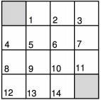
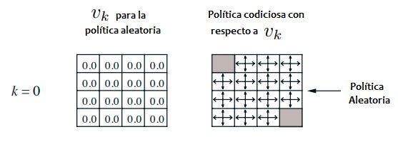
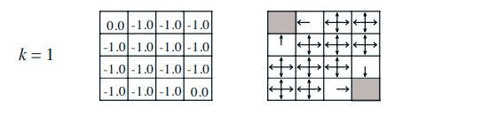
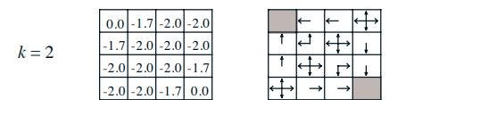
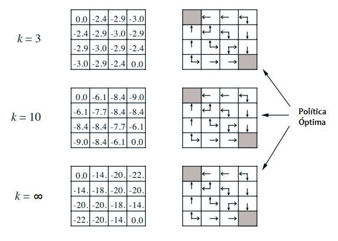
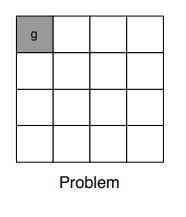
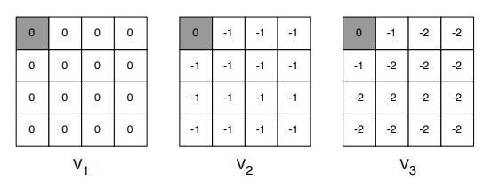
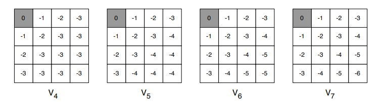

Ahora que ya hemos visto cómo formalizar el problema de RL dentro de la serie de [Aprendizaje por Refuerzo](../../index.qmd), ahora el siguiente paso es resolverlo, para esto en este y los siguientes posts veremos diferentes técnicas y cómo aplicarlas para resolver dichos problemas.\
Una de las técnicas más antiguas y conocidas es la programación dinámica.

## Introducción

Programación dinámica viene de las palabras “programación” que en matemáticas viene a significar “optimizar un programa”, y en este caso por un programa nos estamos refiriendo a una política, por otro lado la palabra dinámica significa que el problema tiene un componente secuencial o temporal. Entonces la definición de programación dinámica vendría a ser un **método de optimización para problemas secuenciales**.

### ¿Y cómo funciona?

Divide el problema en “sub-problemas” y los resuelve, luego vuelve a unir estos sub-problemas para encontrar la solución general.\
Para que la programación dinámica pueda ocurrir deben cumplirse dos propiedades muy importantes:

- **Sub-estructura óptima**\
   Para que se cumpla esta propiedad debe cumplirse el principio de optimalidad, lo cual significa que el problema se puede resolver si se parte en 2 o más sub-problemas y las óptimas soluciones para esos sub-problemas al unirlas dan como resultado la solución óptima a todo el problema.
- **Sub-problemas superpuestos**\
  Significa que los sub-problemas se repiten muchas veces, de modo que sus soluciones se pueden guardar y reutilizar en vez de volver a calcularlas, y por lo tanto la solución es hallada más rápidamente.

### ¿Los Procesos de Decisión de Markov cumplen estas propiedades?

Sí, las cumplen debido a la ecuación de Bellman, que permite descomponer el MDP, eso cumple la propiedad de sub-estructura óptima.\
Pero, ¿qué hay de sub-problemas superpuestos? Bueno, para esto existe la función de valor, la cual guarda los mejores valores y decisiones a tomar, para la cual ya no se necesita re-calcular si se llega a un estado en donde ya se tiene el máximo valor hallado previamente.

## Planificación con Programación Dinámica

La programación dinámica no afecta al problema completo de RL, sino que asume que se conoce completamente el ambiente.\
Ahora la programación dinámica nos puede servir para dos casos especiales de planificación en un MDP.\
Primero podríamos tomarlo como un **caso de predicción**, que como entrada le daríamos un MDP\<S, A, P, R, γ\> y una política π o un MRP\<S, Pπ, Rπ, γ\> y como salida obtendremos una función de valor π, esta función de valor nos va a decir cuánta recompensa esperar en cada estado de este MDP, en otras palabras evaluará nuestra política.\
El otro **caso sería como control**, para obtener la mayor optimización de este MDP, para esto también tendríamos como entrada un MDP\<S, A, P, R, γ\> pero en este caso la salida sería la política óptima que deseamos encontrar y la función de valor óptima.

### Evaluación de Política

Comenzaremos viendo el primero de los casos, el problema que resolveremos será evaluar la política π y lo vamos a hacer utilizando la ecuación de expectativa de Bellman, la cual vimos en el anterior post.\
Para este proceso iniciaremos con un vector de valores arbitrarios “v”, utilizando en el cual dentro de cada iteración se aplicará la ecuación de expectativa de Bellman para ir conociendo los valores de los otros estados raíces, este proceso irá variando utilizando los estados que previamente fueron utilizados como raíces para luego utilizarlos como nodos hijos y hallar el valor del estado raíz, así se seguirá iterando hasta finalmente llegar al valor de vπ, **el utilizar todos los estados a la vez, en cada iteración es llamado Synchronous Backups**. En otras palabras significa que volveremos la ecuación de expectativa de Bellman en actualizaciones iterativas.\
Para entender mejor este problema propondremos el ejemplo de un mundo cuadrícula de tamaño 4 x 4:



- El descuento será de 1
- El estado 0 y el 15 serán los estados terminales de nuestro MDP.
- Se podrá desempeñar 4 acciones, ir a la derecha, izquierda, arriba, abajo.
- La recompensa es -1 hasta que se llega al estado terminal.
- Movimientos que te llevan fuera del mundo te devuelven al mismo estado (con recompensa -1).
- La política será que la probabilidad de tomar cualquier dirección será la misma, o sea 0.25, básicamente al azar.

**Desarrollo**

Se iniciará con una función de valor arbitrarios, que en este caso serán ceros, en este caso, los ceros de la imagen de la izquierda representan cuántos pasos se necesitan en promedio para llegar a los estados finales.



Ahora aplicamos la función de expectativa de Bellman para cada uno de los estados, para hacer esto seleccionamos un estado como ejemplo, en este caso el estado (0, 1), vemos que cualquiera sea la dirección que tome se llevará como recompensa -1 y esto se le suma el valor que tiene el estado donde se encontraría, entonces tendríamos que el nuevo valor para el estado (0,1) sería (-1+0)(1/4)+(-1+0)(1/4)+(-1+0)(1/4)+(-1+0)(1/4) = -1.

El valor de los estados finales no cambian, porque ya no necesita cambiar de estado cuando llegan a este.



Ahora teniendo esta nueva función de valor aplicaremos de nuevo el mismo proceso iterativo, tomando como ejemplo el mismo estado (0, 1) ahora veremos cómo cambia su valor de la siguiente manera, dado que tiene la misma probabilidad de tomar cualquier dirección: (-1+-1)(1/4)+(-1+-1)(1/4)+(-1+-1)(1/4)+(-1+0)(1/4) = -1.75 (en la figura aparece como -1.7)



Ahora si seguimos iterando el proceso, se encontrará que llega a converger. En la parte derecha del gráfico se puede ver cómo sería una política voraz («codiciosa» en la figura) si se eligiera siempre el estado con mayor valor, lo cual demuestra que no es necesario iterar hasta la convergencia para encontrar la política óptima y que observar la función de valor puede servirnos para encontrar una mejor política.



### Iteración de Política

Todo parte de la premisa: ¿Cómo podríamos encontrar una mejor política a la que ya tenemos?

Para lograr esto se partirá el proceso en dos, dada la política π:

- Evaluamos la política π y encontramos su función de valor.
- Mejoras la política actuando de forma voraz (seleccionas el estado que da más valor en cada paso) con respecto a la función de valor.

En el caso del mundo de cuadrícula solo se necesita una iteración sobre la política inicial para hallar la política óptima actuando de forma voraz sobre esa función de valor, pero para otros problemas más complejos se necesita muchas más iteraciones y evaluaciones para llegar a una solución final.

Este proceso se repite una y otra vez hasta que la política deja de mejorar, en este caso habrá convergido en la política óptima, en realidad es un proceso iterativo que resulta al juntar la evaluación de una política y luego sobre esta evaluación se actúa de forma voraz sobre su función de valor y luego se encuentra una mejor política (también llamada iteración de política), estas iteraciones se siguen dando hasta que se termina con la política óptima para ese problema.

**Principio de Optimalidad**

Cada política óptima puede dividirse en dos componentes:

- Elegir una primera acción óptima.
- Seguida por una política óptima desde el estado sucesor S’.

Esto se puede expresar en el teorema del principio de optimalidad: una política π alcanza el valor óptimo desde un estado s, $v_\pi(s) = v_*(s)$, si y solo si, para cualquier estado s’ que pueda ser alcanzado desde s, π alcanza el valor óptimo desde s’, $v_\pi(s') = v_*(s')$.

### Iteración de Valor

Se basa en que si sabemos la solución para el subproblema v\*(s’), podemos hallar la solución de v\*(s), la idea se basa en iniciar desde la recompensa final e ir retrocediendo para encontrar el valor óptimo de cada uno de los estados anteriores.

A continuación se verá un ejemplo del mundo cuadrícula, el mismo que vimos en el ejemplo anterior, pero esta vez solo con una salida.



Para resolver este ejemplo se seleccionará la acción que nos dé mayor valor, esto nos permitirá llegar a la función de valor óptima luego de iterar algunas veces. De nuevo iniciamos nuestro mundo cuadrícula con un valor arbitrario como se muestra en V1, en el siguiente paso se actualizan todos los estados, esta vez **tomando la acción que maximice el valor**, en este caso (V2) todas darían el mismo valor, para V3 la situación ya cambia, se puede notar los estados posicionados en (0,1) y (1,0) eligieron la acción de llegar al estado terminal, la cual termina siendo la acción más óptima.



En las siguientes iteraciones se puede notar cómo cada estado va tomando la acción que maximiza su valor hasta llegar a converger en la función de valor óptima.



Para aterrizar un poco el uso de la iteración por valor tenemos que el objetivo final de esta es encontrar la política óptima π por medio de la aplicación iterativa de la ecuación de optimalidad de Bellman, si se decide detener el algoritmo en alguna iteración no final, puede ser que la función de valor que se encuentre en el algoritmo no sea necesariamente representada por alguna política, ya que la iteración de valor no se basa en ir iterando políticas sino ir alterando la función de valor, pero al final del funcionamiento de este algoritmo sí tendremos claro que se ha encontrado la mejor función de valor que corresponde a la mejor política seleccionando cada vez la acción que genere mayor valor.

### Algoritmos de Programación Dinámica Síncrona

Ahora un resumen de lo que hemos visto:

<!-- antes una imagen: img-09.jpeg -->
| Problema | Ecuación de Bellman | Algoritmo |
|---|---|---|
| Predicción | Ecuación de expectativa de Bellman | Evaluación de Política |
| Control | Ecuación de expectativa de Bellman + Mejoramiento con Política Voraz | Iteración de Política |
| Control | Ecuación de optimalidad de Bellman | Iteración de Valor |

## Implementación

```{.python filename="gridworld.py"}
import numpy as np

def actualizar(funcion_de_valor, politica, longitud_del_mundo, recompensa,
               descuento=1):
    nueva_funcion_de_valor = np.zeros((longitud_del_mundo, longitud_del_mundo))
    #se genera una matriz con ceros, la cual remplazara a la funcion de valor
    # existente
    for posicion_en_el_mundo, valor in np.ndenumerate(funcion_de_valor):
        posicion_en_el_mundo = np.asarray(posicion_en_el_mundo)
        if not es_estado_terminal(posicion_en_el_mundo, longitud_del_mundo):
            #se confirma si el estado es terminal o no
            nuevo_valor = 0
            for _, accion_individual in politica.items():
                #se iterara por cada una de las acciones de nuestra politica
                nueva_posicion = (posicion_en_el_mundo +
                                  accion_individual['accion'])
                x, y = nueva_posicion.T
                if (x < 0 or x >= longitud_del_mundo or y < 0 or y >=
                    longitud_del_mundo):                  
                    #nos fijamos si esta dentro del mundo, si no se le devuelve
                    #a la misma posicion
                    nueva_posicion = posicion_en_el_mundo
                nuevo_valor += (accion_individual['probabilidad'] *
                                (recompensa + descuento *
                                 funcion_de_valor[tuple(nueva_posicion)]))
                    #se genera el nuevo valor que remplazara ese estado
            nueva_funcion_de_valor[tuple(posicion_en_el_mundo)] = nuevo_valor
    return nueva_funcion_de_valor

def es_estado_terminal(posicion_en_el_mundo, longitud_del_mundo):
    '''esta funcion hara que la funcion de valor no sufra ningun cambio cuando
    se encuentre en los estados terminales'''
    inicio = np.array([0,0])
    final = np.array([longitud_del_mundo-1, longitud_del_mundo-1])
    return (np.array_equal(posicion_en_el_mundo, inicio) or
            np.array_equal(posicion_en_el_mundo, final))

def mundo_cuadricula(longitud_del_mundo, politica, recompensa, k=1000):
    funcion_de_valor = np.zeros((longitud_del_mundo, longitud_del_mundo))
    #la funcion inicial arbitraria inicializa con una matriz de ceros
    for iteracion in range(k):
        #se va a actualizar la funcion de valor basado en el valor de k
        funcion_de_valor_nueva = actualizar(funcion_de_valor, politica,
                                            longitud_del_mundo, recompensa)
        if np.array_equal(funcion_de_valor_nueva, funcion_de_valor):
            #si la politica deja de cambiar significa que se habra
            #encontrado una solucion
            print("convergio! a la iteracion:", iteracion)
            break
        else:
            funcion_de_valor = funcion_de_valor_nueva
        print(funcion_de_valor)

if __name__ == '__main__':
    recompensa = -1
    longitud_del_mundo = 4 #el tamaño del mundo sera una cuadricula 4 x 4
    politica = {           #la politica es la misma que se explico en el post
        'derecha' : {
            'probabilidad': 0.25,
            'accion': np.array([0, 1])
        },
        'izquierda' : {
            'probabilidad': 0.25,
            'accion': np.array([0, -1])
        },
        'arriba' : {
            'probabilidad': 0.25,
            'accion': np.array([1, 0])
        },
        'abajo' : {
            'probabilidad': 0.25,
            'accion': np.array([-1, 0])
        }
    }
    mundo_cuadricula(longitud_del_mundo, politica, recompensa)
```

Al ejecutarlo imprime la función de valor en cada iteración. Estas son las últimas líneas de la salida, que coinciden con la función de valor final de la figura 4.1 del libro de Sutton y Barto:

::: {.nb-output}
```
[[  0. -14. -20. -22.]
 [-14. -18. -20. -20.]
 [-20. -20. -18. -14.]
 [-22. -20. -14.   0.]]
convergio! a la iteracion: 633
```
:::

El código está en [GitHub](https://github.com/miguelsilva15/Blog-AprendizajePorRefuerzo/blob/master/RL-4-GridWorld/gridworld.py).

Con esto concluimos el tema de programación dinámica, si hubiera alguna duda por favor déjala en los comentarios y espero haberte ayudado con este tema, sigue la serie de mis posts que pronto iré añadiendo más.

¡Muchas gracias!

## Referencias

- [UCL Course on RL Lecture 3: Planning by Dynamic Programming](https://davidstarsilver.wordpress.com/wp-content/uploads/2025/04/lecture-3-planning-by-dynamic-programming-.pdf)
- [Inspiración del ejemplo del mundo cuadrícula](https://github.com/ShangtongZhang/reinforcement-learning-an-introduction/blob/master/chapter04/grid_world.py)
- [Richard Sutton’s Intro to Reinforcement Learning](http://incompleteideas.net/book/RLbook2018.pdf)
