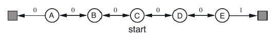

La predicción sin modelo se basa en tener un problema que se pueda expresar por medio de un MDP, pero no necesariamente conocemos la estructura de este, por lo tanto, no sabemos cómo funcionan realmente las mecánicas de este ambiente, siendo el objetivo estimar qué tan buena es una política dada, es decir su función de valor, en ese ambiente desconocido.

## Introducción

En el anterior post vimos cómo resolver un MDP que se conocía por completo, en este post veremos cómo estimar la función de valor de un ***MDP desconocido***.

## Aprendizaje de Monte-Carlo

El algoritmo de aprendizaje de Monte-Carlo nos sirve para estimar la función de valor, toma muestras directamente de episodios realizados por un agente dada la política que elegimos, funciona mejor para ambientes que tienen las características de juegos, es decir, que siempre tienen un final.

### ¿Cómo funciona el MC?

MC estima la función de valor repitiendo una y otra vez la política elegida desde un estado *s* hasta el final del episodio, al terminar de realizar estas pruebas se promedia todo el retorno obtenido (El retorno representa el total de recompensa utilizando el factor de descuento) y de esta manera se encuentra la función de valor para dicha política, esta es la manera más “simple” de encontrar la función de valor, el aprendizaje de Monte-Carlo se puede ejecutar de dos maneras:

**Evaluación de Política de Primera Visita de Monte-Carlo**

Para evaluar la política π se inicia seleccionando un estado *s*:

1.  Se genera una muestra ejecutando la política π sobre el ambiente.
2.  Se iniciará un episodio si se visita el estado *s* en dicha muestra, solo se considera un episodio si por lo menos se pasa una vez por el estado *s*.
3.  Se añadirá el valor de uno a un contador *n* por **la primera vez que se visite el estado *s* por episodio** (que llevará la cuenta de cuántas veces se ha visitado el estado *s* en el total de nuestros episodios).
4.  Se contabilizará el valor del retorno final desde que se visite el estado s por primera vez por episodio hacia adelante, el cual luego se guardará junto al retorno de los siguientes episodios que también pasen por el estado s, el retorno se contabilizará desde el momento que se visita el estado s por primera vez hasta el final del episodio.
5.  Luego de ejecutar el algoritmo hasta que se estabilicen los valores se hallará la media del retorno total dividiendo el retorno total entre el contador n, la cual nos dará como resultado la función de valor de la política π.\
    Según [la ley de los grandes números](https://es.wikipedia.org/wiki/Ley_de_los_grandes_n%C3%BAmeros), si tomamos el promedio de un gran número de episodios eventualmente se acercará y convergerá en la función de valor de la política π, como requisito para que funcione esta evaluación de política se necesita que se visiten todos los estados que pueden ser alcanzados por la política π por lo menos una vez, y esto se logra al reproducir el experimento un gran número de veces.

**Evaluación de Política de Cada Visita de Monte-Carlo**

Para evaluar la política π se iniciará de nuevo seleccionando un estado *s*:

1.  Se genera una muestra ejecutando la política π sobre el ambiente.
2.  Se iniciará un episodio si se visita el estado *s* en dicha muestra, **se considera un episodio cada vez que se pasa por el estado *s***.
3.  Se añadirá el valor de uno a un contador *n* por cada vez que se visite el estado *s*.
4.  Se contabilizará el valor del retorno final desde que se visite el estado *s* hasta el final del episodio, el cual luego se guardará junto al retorno de los siguientes episodios.
5.  Luego de ejecutar el programa las veces que uno crea necesario se hallará la media del retorno total dividiendo el retorno total entre el contador *n*, la cual nos dará como resultado la función de valor de la política π.

Como se ve, la diferencia con este método es que cada vez que se visita el estado *s*, se generará un nuevo episodio del cual se contabilizará el retorno desde el momento que visitan el estado, hasta el final.

**Media Incremental**

La media de una secuencia puede calcularse incrementalmente dándole forma a la ecuación de la siguiente manera:

<!-- antes una imagen: img-02.jpeg -->
$$
\begin{aligned}
\mu_k &= \frac{1}{k} \sum_{j=1}^{k} x_j \\
&= \frac{1}{k} \left( x_k + \sum_{j=1}^{k-1} x_j \right) \\
&= \frac{1}{k} \left( x_k + (k-1)\mu_{k-1} \right) \\
&= \mu_{k-1} + \frac{1}{k} \left( x_k - \mu_{k-1} \right)
\end{aligned}
$$

Esto permitiría que el algoritmo de aprendizaje de Monte-Carlo pueda ser actualizado al final de cada episodio, en este caso sería representado de la siguiente manera:

<!-- antes una imagen: img-03.png -->
$$
\begin{aligned}
N(S_t) &\leftarrow N(S_t) + 1 \\
V(S_t) &\leftarrow V(S_t) + \frac{1}{N(S_t)} \left( G_t - V(S_t) \right)
\end{aligned}
$$

*N* representa el contador dentro del algoritmo de Monte-Carlo, *V* la función de valor, *G* el retorno y *S* el estado.

[Aquí una pequeña implementación de MC en Python](https://github.com/miguelsilva15/Blog-AprendizajePorRefuerzo/blob/master/RL-5-PrediccionesSinModelo/Monte-Carlo.ipynb), para que el concepto quede más claro.

:::: {.callout-note collapse="true"}
## Código: Monte-Carlo

Usa el ambiente de la cadena (`ambiente_cadena.py`), que se describe en [Implementación](#implementación). El notebook completo está en [GitHub](https://github.com/miguelsilva15/Blog-AprendizajePorRefuerzo/blob/master/RL-5-PrediccionesSinModelo/Monte-Carlo.ipynb).

```python
import numpy as np
from ambiente_cadena import Cadena

np.random.seed(666)
```

```python
def politica():
    return np.random.choice([-1,1])
```

```python
numero_de_estados = 7 #número de estados del ambiente.

valores = np.zeros(numero_de_estados) # se inicializará los valores de los estados en 0.
estados_visitados = np.zeros(numero_de_estados)

ambiente = Cadena() #se inicializa el ambiente.
episodios = 2000 #número de episodios.
contador = 0
recompensa_total = 0
# variables del algoritmo

alpha = 0.25 #variable por la que se multiplica el error. 

while True:
    accion = politica() #se genera una acción.
    estado_anterior = ambiente.estado_actual()
    estados_visitados[estado_anterior] = 1
    recompensa, nuevo_estado, _, final_episodio = ambiente.movimiento(accion)
    recompensa_total += recompensa
    if final_episodio:
        valores += alpha * (recompensa_total - valores)*estados_visitados
        ambiente = Cadena() #reiniciamos el ambiente
        recompensa_total = 0
        estados_visitados = np.zeros(numero_de_estados)
        contador+=1 #se suma un episodio mas terminado
        if contador % 400 == 0:
            print('Episodio :', contador)
    if contador == episodios:
        break
```

::: {.nb-output}
```
Episodio : 400
Episodio : 800
Episodio : 1200
Episodio : 1600
Episodio : 2000
```
:::

```python
valores[1:6] #valor final de cada estado.
```

::: {.nb-output}
```
array([0.14487967, 0.17365872, 0.33387811, 0.65040468, 0.74735077])
```
:::
::::

## Método de Diferencia Temporal

Este método aprende directamente de episodios de experiencias, también funciona sin modelo.

### ¿Cómo funciona el TD?

El método de diferencia temporal aprende de episodios incompletos por medio de **bootstrapping**, esta técnica consiste en tomar un camino parcialmente y estimar cuál sería el retorno de este sin recorrerlo en su totalidad, este retorno estimado se ve actualizado cuando el agente tome otro paso en dirección hacia este camino.

El objetivo es aprender la función de valor de manera *online*, bajo la política π:\
Como se había mostrado TD se encarga de encontrar el retorno estimado (también llamado TD target u Objetivo TD), el cual se representa con la siguiente fórmula:

$$
R_{t+1} + \gamma V(S_{t+1})
$$

Esta fórmula nos muestra que el retorno estimado puede ser representado como la recompensa inmediata más el valor estimado (y descontado) del resto de la trayectoria. Ahora, partimos de la fórmula de Actualización *Online* de MC:

<!-- antes una imagen: img-04.png -->
$$
V(S_t) \leftarrow V(S_t) + \alpha \left( G_t - V(S_t) \right)
$$

y variaremos el retorno real *Gt*, por el retorno estimado, dejándonos la siguiente fórmula:

<!-- antes una imagen: img-05.png -->
$$
V(S_t) \leftarrow V(S_t) + \alpha \left( R_{t+1} + \gamma V(S_{t+1}) - V(S_t) \right)
$$

La parte final de la fórmula que se encuentra entre paréntesis es llamada Error TD.

## MC vs TD

### TD

- Puede aprender antes de ver el resultado final, debido a que puede estimar cuál será el retorno de una situación dado el punto en donde se encuentra, esto quiere decir que TD puede ir aprendiendo durante cada paso dentro del camino.
- Puede aprender de episodios incompletos, es decir de episodios donde no se llega nunca a un estado final.
- TD busca la máxima verosimilitud para un modelo de Markov (intenta construir un MDP que encaje de mejor manera con los datos).
- Aprovecha la propiedad de Markov, por lo que suele ser más eficiente en ambientes que la cumplen.

### MC

- Debe esperar hasta el final del episodio para saber el retorno.
- Solo puede aprender de secuencias completas.
- Busca la solución con menor error cuadrático medio (Se basa en el retorno obtenido).
- No aprovecha la propiedad de Markov, por lo que suele funcionar mejor en ambientes que no la cumplen.

### Intercambio entre el Sesgo y la Varianza

- El retorno que da MC no tiene ningún sesgo.
- El retorno estimado de TD (o TD target) se encuentra sesgado, debido a que podemos estimarlo equivocadamente.
- El TD target tiene menor varianza, debido a que solo depende de una acción aleatoria, una transición y un retorno, en cambio el retorno real depende de varias acciones aleatorias, varias transiciones y varios retornos.

## TD(λ)

### **Predicción de N-pasos**

Ahora que sabemos cómo funciona MC y TD, sería válido pensar, ¿Por qué TD solo toma un paso antes de estimar la función de valor? ¿Por qué no tomar 2 o 3? Esta es la idea detrás de predicción de n-pasos. Hasta este punto hemos visto cómo funciona TD utilizando solo un paso, llamado TD(0) y también cómo funciona MC, algoritmo que recorre todos los estados antes de generar una estimación, pero en esta sección veremos qué se encuentra entre estos dos algoritmos.

Veremos cómo definir el retorno para n-pasos:

<!-- antes una imagen: img-06.jpeg -->
$$
G_t^{(n)} = R_{t+1} + \gamma R_{t+2} + \dots + \gamma^{n-1} R_{t+n} + \gamma^n V(S_{t+n})
$$

Para este caso, el retorno se define como el retorno para todos los pasos dados en el ambiente y una estimación del retorno que vendría hasta la terminación de este episodio.

Podríamos añadir esto, para generar la función TD para n-pasos:

<!-- antes una imagen: img-07.png -->
$$
V(S_t) \leftarrow V(S_t) + \alpha \left( G_t^{(n)} - V(S_t) \right)
$$

Dadas las posibilidades que se muestran ahora, ¿Cómo podríamos elegir un *n* que sea mejor para cualquier problema? ¿Podríamos promediar varios retornos?

Sí, en realidad se puede promediar varios retornos para obtener lo mejor de ellos, es decir, podríamos promediar el retorno de un *n = 4* y de un *n = 2* y utilizarlo como TD target, así obtendríamos lo mejor de ambos.

### Retorno λ

El retorno λ combina el retorno de todos los n utilizando una media ponderada, el retorno cambia a la siguiente fórmula:

<!-- antes una imagen: img-08.jpeg -->
$$
G_t^\lambda = (1 - \lambda) \sum_{n=1}^{\infty} \lambda^{n-1} G_t^{(n)}
$$

Donde λ es un número entre 0 y 1.

Lo cual genera la siguiente fórmula para TD(λ) hacia adelante.

<!-- antes una imagen: img-09.jpeg -->
$$
V(S_t) \leftarrow V(S_t) + \alpha \left( G_t^\lambda - V(S_t) \right)
$$

Esa vista de TD(λ) es más que nada teórica, si se desea poner en práctica TD(λ) se necesita utilizar TD(λ) hacia atrás, debido a que no podemos saber actualmente cuánto es el valor para cada estado que viene hacia delante en nuestro MDP, es por eso que nos basamos en TD(λ) hacia atrás que nos permite actualizar nuestro valor basado en las recompensas que recibimos y los estados que hemos visitado.

### Rastros de Elegibilidad

Si quisiéramos actualizar nuestra función de valor; ¿A qué estado deberíamos asignarle más o menos “responsabilidad” por el descenso del retorno?

Es por esto que nace el concepto de rastros de elegibilidad, que mantiene un conteo de qué tan recientemente se visita cada estado y con qué frecuencia, esto nos da una idea de cómo penalizar más justamente a cada estado, y actualizar nuestra función de valor.

Esta fórmula es TD(λ) hacia atrás utilizando rastros de elegibilidad.

<!-- antes una imagen: img-10.png -->
$$
\begin{aligned}
\delta_t &= R_{t+1} + \gamma V(S_{t+1}) - V(S_t) \\
V(s) &\leftarrow V(s) + \alpha \delta_t E_t(s)
\end{aligned}
$$

*Et(s)* representa los rastros de elegibilidad, que designará qué estado se actualizará en mayor medida que otro; δ representará el error de TD.

## Implementación

A continuación comparto una implementación de TD(λ), si deseas ver el código completo y una implementación de Monte-Carlo visita [mi página de GitHub](https://github.com/miguelsilva15/Blog-AprendizajePorRefuerzo/tree/master/RL-5-PrediccionesSinModelo).

En este caso utilizaremos el siguiente ambiente:



Para ejemplificar cómo funcionaría con una política aleatoria, en este caso la política decidirá con igual probabilidad moverse hacia la izquierda o derecha, la peculiaridad de este ambiente es que solo se recompensa cuando se llega al estado final de la derecha, para el estado de la izquierda no hay premio alguno.

::: {.callout-note collapse="true"}
## Código de apoyo: `ambiente_cadena.py`

```python
class Cadena:   
    
    nodos = ["F1", "A", "B", "C", "D", "E", "F2"]
    def __init__(self):
        self.posicion = 3 # posicion inicial
        self.terminado = False
        self.nodo = self.nodos[self.posicion]
    
    def estado_actual(self):
        return self.posicion
        
    def movimiento(self, decision):
        if not self.terminado:
            nueva_posicion = self.posicion + decision    
            recompensa = self.obtener_recompensa(nueva_posicion)
            self.posicion = nueva_posicion
            self.nodo = self.nodos[self.posicion]
            if self.nodo in ['F1', 'F2']:
                self.terminado = True
            return recompensa, self.posicion, self.nodo, self.terminado
        
    def obtener_recompensa(self, nueva_posicion):
        return 1.0 if self.nodos[nueva_posicion] == "F2" else 0.0
```
:::

```python
import numpy as np
from ambiente_cadena import Cadena

np.random.seed(666)
```

```python
def politica():
    return np.random.choice([-1,1])
```

```python
numero_de_estados = 7 #número de estados del ambiente.

valores = np.zeros(numero_de_estados) # se inicializará los valores de los estados en 0.
elegibilidad = np.zeros(numero_de_estados) # con este vector se llevará la cuenta de los estados visitados.

ambiente = Cadena() #se inicializa el ambiente.
episodios = 2000 #número de episodios.
contador = 0

# variables del algoritmo

lambd = 0.7 #variable lambda de TD(lambda).
alpha = 0.25 #variable por la que se multiplica el error. 
gamma = 0.7 #variable por la cual verá reducido la elegibilidad de cada estado.


while True:
    accion = politica() #se genera una acción.
    estado_anterior = ambiente.estado_actual()
    recompensa, nuevo_estado, _, final_episodio = ambiente.movimiento(accion)
    elegibilidad *= lambd* gamma
    elegibilidad[estado_anterior] += 1.0
    td_error = recompensa + gamma * valores[nuevo_estado] - valores[estado_anterior]
    valores += alpha * td_error * elegibilidad
    if final_episodio:
        elegibilidad = np.zeros(numero_de_estados)
        ambiente = Cadena() #reiniciamos el ambiente
        contador+=1 #se suma un episodio mas terminado
        if contador % 400 == 0:
            print('Episodio :', contador)
    if contador == episodios:
        break
```

::: {.nb-output}
```
Episodio : 400
Episodio : 800
Episodio : 1200
Episodio : 1600
Episodio : 2000
```
:::

```python
valores[1:6] #valor final de cada estado.
```

::: {.nb-output}
```
array([0.01023519, 0.01805448, 0.0570654 , 0.18990032, 0.62445833])
```
:::

El notebook completo está en [GitHub](https://github.com/miguelsilva15/Blog-AprendizajePorRefuerzo/blob/master/RL-5-PrediccionesSinModelo/TD-Lambda.ipynb).

Esto es todo lo que veremos por este post, espero que les sea de ayuda y cualquier duda por favor escribirme.

¡Muchas gracias!

## Referencias

- [UCL Course on RL Lecture 4: Model-Free Prediction](https://davidstarsilver.wordpress.com/wp-content/uploads/2025/04/lecture-4-model-free-prediction-.pdf)
- [Richard Sutton’s Intro to Reinforcement Learning](http://incompleteideas.net/book/RLbook2018.pdf)
