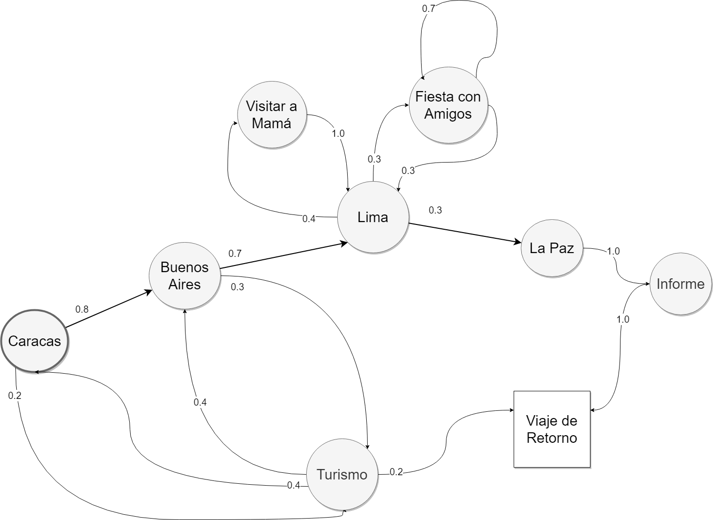
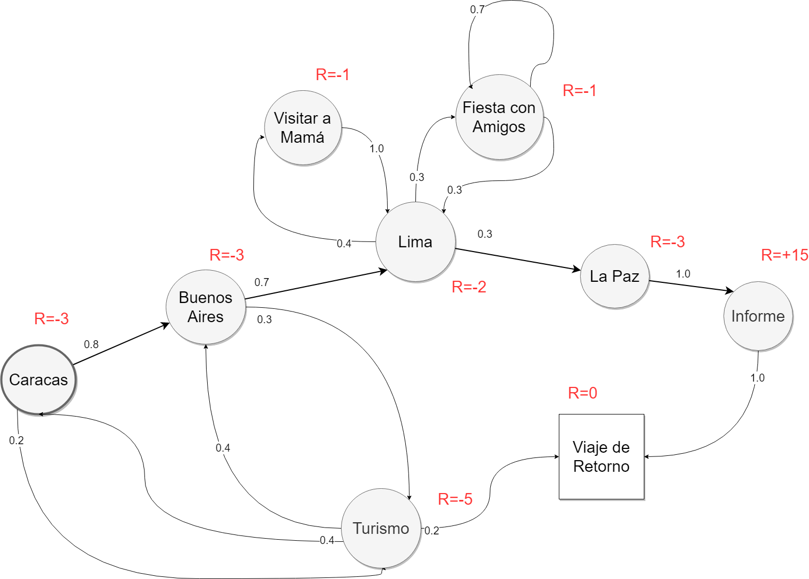
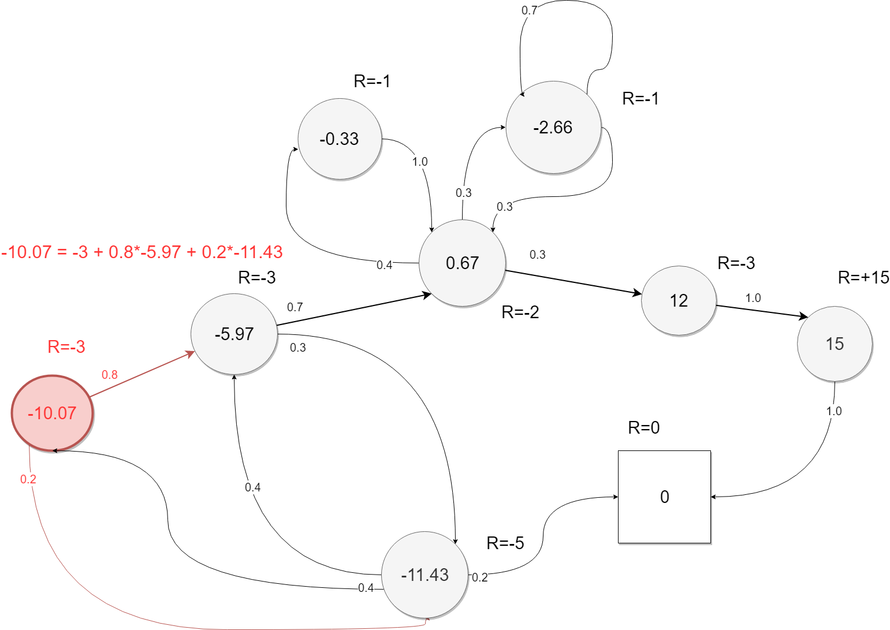

Siguiendo con la serie de [Aprendizaje por Refuerzo](../../index.qmd) en esta ocasión conoceremos más sobre procesos de decisión de Markov comenzando desde lo más básico y subiendo el nivel de complejidad de conceptos hasta explicar por completo todo el tema.

## Procesos de Markov

### Introducción

Los MDP (Procesos de Decisión de Markov) son la forma idealizada matemáticamente del problema de aprendizaje por refuerzo, para el cual se podría encontrar un enunciado teórico preciso que pueda describirla, en otras palabras los MDP describen formalmente el medio ambiente en el cual se desarrolla el RL, donde el medio ambiente es completamente observable, esto da como consecuencia que la mayoría de problemas dentro del RL se pueden formalizar como MDPs. Con los MDP se introducen varios elementos clave para la descripción matemática del problema, como el retorno, funciones de valor y **las ecuaciones de Bellman**.

### Propiedad de Markov

La propiedad de Markov nos muestra que el futuro es independiente del pasado, dado el presente, lo cual se expresa en la siguiente fórmula:

<!-- antes una imagen: img-01.png -->
$$
\mathbb{P}[S_{t+1} \mid S_t] = \mathbb{P}[S_{t+1} \mid S_1, \dots, S_t]
$$

La cual significa que el estado actual (representado por Sₜ) contiene toda la información relevante de los estados pasados (S₁,….. Sₜ), por lo tanto ya no nos serviría tener mayor información de los estados pasados.

### Matriz de transición de estados

Ahora pasaremos a ver la llamada matriz de transición de estados, la cual nos muestra cuál sería la probabilidad de transición desde un estado S a un estado S’ y en donde cada fila sumaría uno, se vería de la siguiente manera, estos conceptos serán mostrados en un ejemplo más adelante.

<!-- antes una imagen: img-02.png -->
$$
\begin{bmatrix}
P_{11} & \cdots & P_{1n} \\
\vdots & & \vdots \\
P_{n1} & \cdots & P_{nn}
\end{bmatrix}
$$

### Definición

Simplificando, un proceso de Markov es un proceso sin memoria y aleatorio; en otras palabras es una **secuencia de estados aleatorios que posee la propiedad de Markov**.\
Se podría definir el proceso de Markov como una tupla \<S,P\>

- S es una lista de estados a los cuales puede pertenecer.
- P es una matriz de transición de estado.

### Ejemplo

En este ejemplo se muestra el caso de un empleado del área de TI en una empresa de maquinarias que reside en México, se le ha encomendado la labor de visitar varias ciudades de Sudamérica donde conversará con varios consultores para encontrar la mejor oferta sobre una consultoría de optimización de procesos de producción, el objetivo de este empleado será escribir un informe en el cual dará su opinión de cada proveedor luego de visitar estas ciudades, en este viaje se verá tentado por hacer turismo en las bellas ciudades que visitará o en permanecer un tiempo en Lima, su ciudad natal, en la cual puede distraerse con amigos o con familia.

Los números representan la probabilidad de ir al siguiente estado.

Ahora veremos cómo podemos sacar muestras de la cadena de Markov propuesta donde se iniciará desde nuestro primer destino, Caracas (S₁= Caracas).

- CARACAS, TURISMO, VIAJE DE RETORNO
- CARACAS, BUENOS AIRES, LIMA, FIESTA CON AMIGOS, FIESTA CON AMIGOS, LIMA, LA PAZ, INFORME, VIAJE DE RETORNO
- CARACAS, BUENOS AIRES, LIMA, VISITAR A MAMÁ, LIMA, LA PAZ, INFORME, VIAJE DE RETORNO
- CARACAS, BUENOS AIRES, LIMA, LA PAZ, INFORME, VIAJE DE RETORNO

Ahora observaremos la matriz de transición de estados para este caso:

|  | CARACAS | TURISMO | BUENOS AIRES | LIMA | VISITAR A MAMÁ | FIESTA CON AMIGOS | LA PAZ | INFORME | VIAJE DE RETORNO |
|---|---|---|---|---|---|---|---|---|---|
| CARACAS |  | 0.2 | 0.8 |  |  |  |  |  |  |
| TURISMO | 0.4 |  | 0.4 |  |  |  |  |  | 0.2 |
| BUENOS AIRES |  | 0.3 |  | 0.7 |  |  |  |  |  |
| LIMA |  |  |  |  | 0.4 | 0.3 | 0.3 |  |  |
| VISITAR A MAMÁ |  |  |  | 1.0 |  |  |  |  |  |
| FIESTA CON AMIGOS |  |  |  | 0.3 |  | 0.7 |  |  |  |
| LA PAZ |  |  |  |  |  |  |  | 1.0 |  |
| INFORME |  |  |  |  |  |  |  |  | 1.0 |
| VIAJE DE RETORNO |  |  |  |  |  |  |  |  | 1 |

## Procesos de Recompensa de Markov

Los procesos de recompensa de Markov se pueden ver como procesos de Markov normales con valores que juzgan qué tan positivo es estar en un estado, esto traería un cambio a la definición de procesos de Markov que tuvimos previamente agregándole dos nuevas variables.

Se podría definir el proceso de recompensa de Markov como una tupla \<S,P,R, γ\>

- **S** es una lista de estados a los cuales puede pertenecer.
- **P** es una matriz de transición de estado.
- **R** es la recompensa inmediata en el estado donde nos encontraríamos, se puede expresar de la siguiente manera

<!-- antes una imagen: img-04.png -->
$$
R_s = \mathbb{E}[R_{t+1} \mid S_t = s]
$$

- **γ** es un valor de descuento que va entre el 0 a 1

Ahora al ejemplo le agregamos los valores de la recompensa en cada estado, que quede claro que para este y los siguientes ejemplos el valor de descuento será de 1 por motivos didácticos (salvo en el ejemplo de retorno de más abajo, que usa 1/3 para que se note su efecto):

### Retorno

El retorno Gₜ es el total de recompensa multiplicado por el valor de descuento en cada paso de tiempo.

<!-- antes una imagen: img-06.png -->
$$
G_t = R_{t+1} + \gamma R_{t+2} + \cdots = \sum_{k=0}^{\infty} \gamma^k R_{t+k+1}
$$

Si el valor del descuento es 0, significa que solo tomas en cuenta la primera recompensa, ya que los demás valores se harían 0; por otro lado si el valor del descuento es 1, significa que se tomará en cuenta todas las recompensas por igual.\
En otras palabras el valor de descuento te permite elegir qué tanto priorizar las recompensas más cercanas o más lejanas.

### ¿Pero por qué es conveniente usar descuento?

- Es matemáticamente conveniente usar descuentos.
- Evita bucles infinitos en procesos de Markov cíclicos.
- No siempre la incertidumbre del futuro puede ser representada.
- El comportamiento animal muestra preferencia por recompensas inmediatas.

También es posible usar procesos de Markov sin descuento, cuando todas las secuencias pueden terminar (por ejemplo el caso propuesto).

### Función de valor

Se representa como v(s) y nos muestra cuál es la recompensa esperada desde ese estado hasta el final de la secuencia.

<!-- antes una imagen: img-07.png -->
$$
v(s) = \mathbb{E}[G_t \mid S_t = s]
$$

### Ejemplo de Retorno de la Cadena de Markov

Comenzando el ejemplo de S₁ = Caracas, γ=1/3

<!-- antes una imagen: img-08.png -->
$$
G_1 = R_2 + \gamma R_3 + \cdots + \gamma^{T-2} R_T
$$

| Ruta | Retorno |
|---|---|
| CARACAS, TURISMO, VIAJE DE RETORNO | $v_1 = -3 - 5 \cdot \tfrac{1}{3} + 0 \cdot \tfrac{1}{9} = -4.67$ |
| CARACAS, BUENOS AIRES, LIMA, FIESTA CON AMIGOS, FIESTA CON AMIGOS, LIMA, LA PAZ, INFORME, VIAJE DE RETORNO | $v_2 = -3 - 3 \cdot \tfrac{1}{3} - 2 \cdot \tfrac{1}{9} - 1 \cdot \tfrac{1}{27} - 1 \cdot \tfrac{1}{81} - 2 \cdot \tfrac{1}{243} - 3 \cdot \tfrac{1}{729} + 15 \cdot \tfrac{1}{2187} + 0 \cdot \tfrac{1}{6561} = -4.28$ |
| CARACAS, BUENOS AIRES, LIMA, VISITAR A MAMÁ, LIMA, LA PAZ, INFORME, VIAJE DE RETORNO | $v_3 = -3 - 3 \cdot \tfrac{1}{3} - 2 \cdot \tfrac{1}{9} - 1 \cdot \tfrac{1}{27} - 2 \cdot \tfrac{1}{81} - 3 \cdot \tfrac{1}{243} + 15 \cdot \tfrac{1}{729} + 0 \cdot \tfrac{1}{2187} = -4.28$ |
| CARACAS, BUENOS AIRES, LIMA, LA PAZ, INFORME, VIAJE DE RETORNO | $v_4 = -3 - 3 \cdot \tfrac{1}{3} - 2 \cdot \tfrac{1}{9} - 3 \cdot \tfrac{1}{27} + 15 \cdot \tfrac{1}{81} + 0 \cdot \tfrac{1}{243} = -4.15$ |

### Ecuación de Bellman

La ecuación de Bellman lo que hace es partir la función de valor en dos, en la recompensa inmediata de ese estado y el valor que vas a obtener luego de ese estado en adelante.

<!-- antes una imagen: img-09.png -->
$$
\begin{aligned}
v(s) &= \mathbb{E}[G_t \mid S_t = s] \\
&= \mathbb{E}[R_{t+1} + \gamma R_{t+2} + \gamma^2 R_{t+3} + \cdots \mid S_t = s] \\
&= \mathbb{E}[R_{t+1} + \gamma (R_{t+2} + \gamma R_{t+3} + \cdots) \mid S_t = s] \\
&= \mathbb{E}[R_{t+1} + \gamma G_{t+1} \mid S_t = s] \\
&= \mathbb{E}[R_{t+1} + \gamma v(S_{t+1}) \mid S_t = s]
\end{aligned}
$$

Básicamente para hallar el valor de un estado se mira en los siguientes y en el valor de cada uno de estos, luego se suman todos estos valores para representar el valor del estado inicial.

Ahora mostraremos la ecuación de Bellman aplicada al MRP de ejemplo, antes explicado.

Como se ve en nuestro gráfico explicaremos el valor de un estado específico (el que se encuentra de color rojo), se toma los valores de los dos posibles estados en los que puede terminar el agente desde el estado inicial, estos dos estados tienen un valor y una probabilidad de terminar en cada uno, estos se multiplican y se suman para hallar el valor del estado inicial.

### Resolviendo la ecuación de Bellman

La ecuación de Bellman es lineal y puede ser resuelta directamente aunque su complejidad es O(n³) para n estados, por lo tanto solo puede ser resuelta de esta manera para MRPs pequeños, para otros casos es recomendado otras técnicas como programación dinámica u otras técnicas.

En el siguiente post veremos el final de este tema explicando los procesos de decisión de Markov y los estados que lo conforman, puedes acceder al siguiente post en [Procesos de decisión de Markov, parte 2.](../procesos-de-decision-de-markov-parte-2/index.qmd)

## Referencias

- [UCL Course on RL Lecture 2: Markov Decisión Processes](https://davidstarsilver.wordpress.com/wp-content/uploads/2025/04/lecture-2-mdp.pdf)
- [Richard Sutton’s Intro to Reinforcement Learning](http://incompleteideas.net/book/RLbook2018.pdf)
