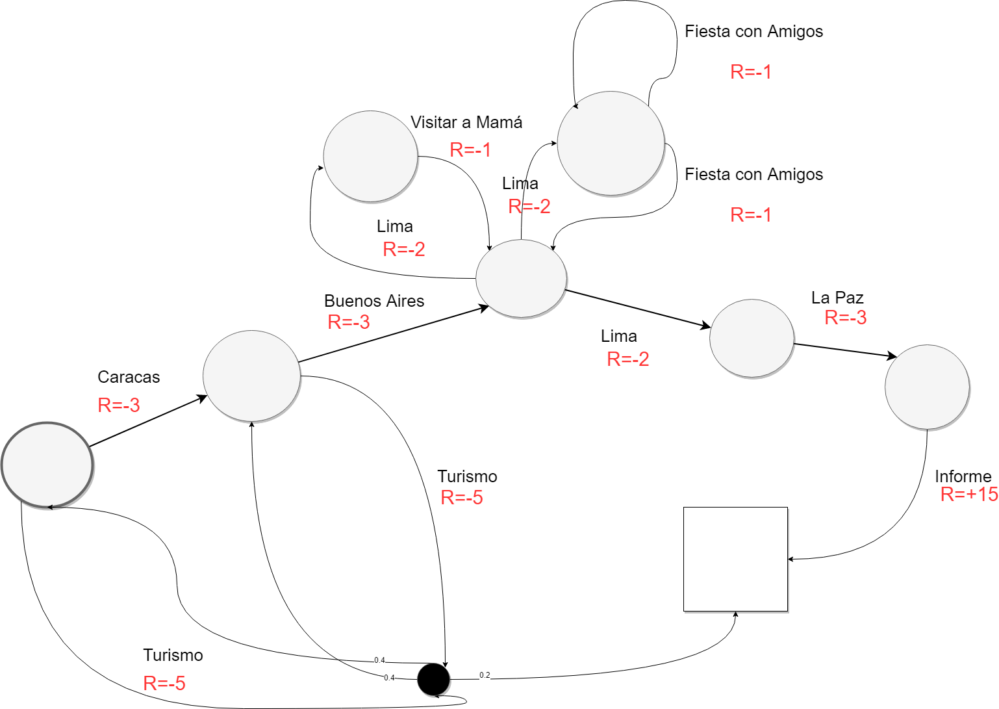
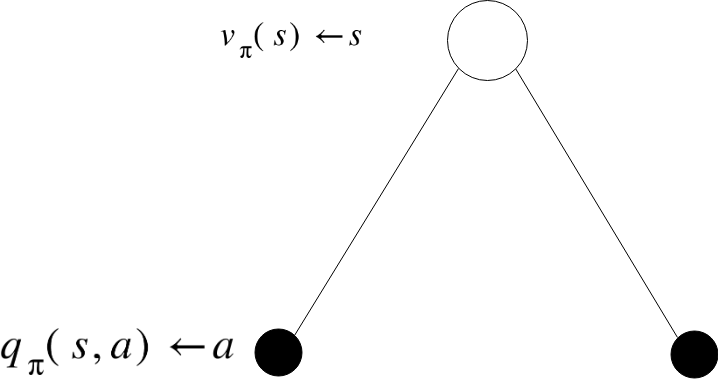
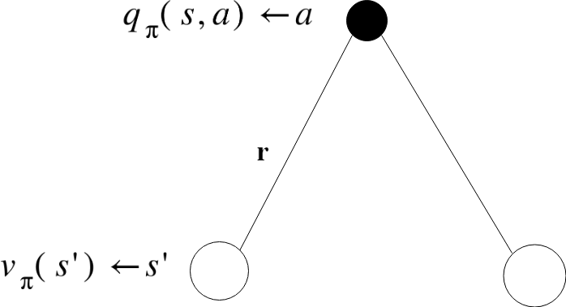
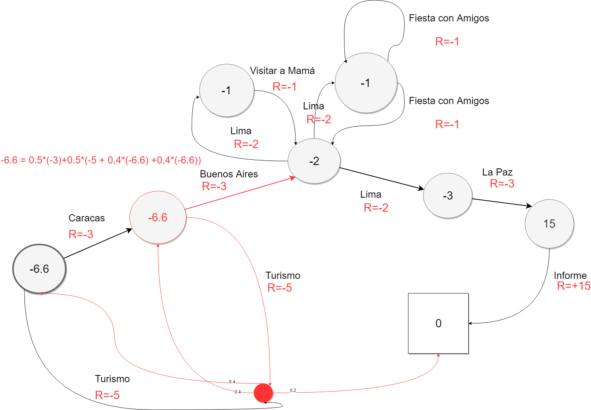
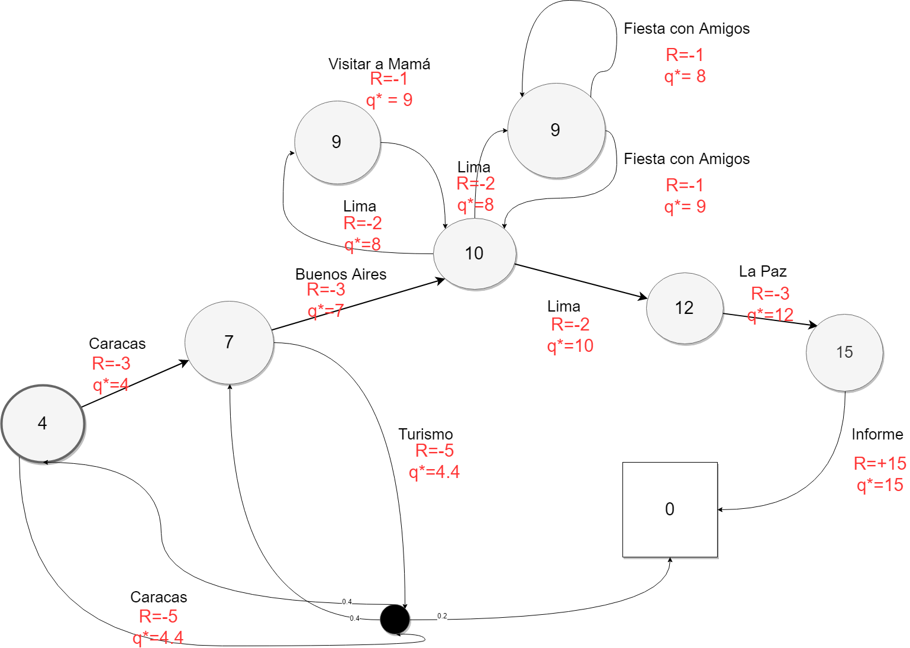

Continuaremos viendo procesos de decisión de Markov esta vez dejaremos de lado las introducciones y nos centraremos en el tema central, si deseas acceder a todos los posts sobre aprendizaje por refuerzo ingresa [aquí](../../index.qmd), si deseas conocer el post de introducción a procesos de decisión de Markov ingresa [aquí](../procesos-de-decision-de-markov-parte-1/index.qmd).

## Procesos de Decisión de Markov

Los procesos de decisión de Markov poseen la misma forma que un proceso de recompensa de Markov pero en este caso se le agregan decisiones que van a ser tomadas por nuestro agente, es decir que ya no se moverá libremente en el sistema.

Ahora para adentrarnos en la definición agregaremos variables a la tupla ya antes explicada en la primera parte de este post \<**S, A, P, R, γ**\>

- **S** es una lista de estados a los cuales puede pertenecer.
- **A** es una lista de acciones.
- **P** es una matriz de transición de estado.
- **R** es la función de recompensa.
- **γ** es el valor de descuento.

En este caso se agregará una lista de acciones que se tomará, debido a que no será un problema en el cual el agente se moverá aleatoriamente en la cadena de Markov sino más bien será una serie de decisiones que nos llevarán a hallar la mayor recompensa.

Ahora que ya hemos definido lo que es un proceso de decisión de Markov actualizaremos nuestro ejemplo en base a estados y decisiones.

En la parte inferior de la cadena de Markov se ve representada una decisión que puede transportarte aleatoriamente (según una probabilidad) a uno de los estados con los cuales está relacionado.

### Políticas

Las políticas se pueden describir como una distribución π de acciones dado estados.

<!-- antes una imagen: img-02.png -->
$$
\pi(a \mid s) = \mathbb{P}[A_t = a \mid S_t = s]
$$

La política depende del estado actual y no de los estados pasados.\
La política es independiente del tiempo, es decir son estacionarias.

### Función de Valor

La función de valor se divide en dos conceptos separados, la función estado-valor, que representa qué tan bueno es un estado (o qué tanto valor tiene) y la función acción-valor que representa qué tan positivo es tomar cierta acción y qué tanto valor nos va a devolver.

**La función de estado-valor** básicamente representa el retorno esperado desde un estado s siguiendo la política π

<!-- antes una imagen: img-03.png -->
$$
v_\pi(s) = \mathbb{E}_\pi[G_t \mid S_t = s]
$$

E representa la expectativa cuando se prueba todas las **acciones** dada la política π.

**La función de acción-valor** iniciando desde el estado s, como la anterior pero tomando una acción a y luego siguiendo la política π para ver cuánto retorno nos trae.

<!-- antes una imagen: img-04.png -->
$$
q_\pi(s, a) = \mathbb{E}_\pi[G_t \mid S_t = s, A_t = a]
$$

### Ecuación de expectativa de Bellman

Esta vez volvemos a ver la ecuación de Bellman desde otro punto de vista:

Para la función de estado-valor puede ser descompuesta en la recompensa inmediata más el valor descontado del siguiente estado siguiendo la política π.

<!-- antes una imagen: img-05.png -->
$$
v_\pi(s) = \mathbb{E}_\pi[R_{t+1} + \gamma v_\pi(S_{t+1}) \mid S_t = s]
$$

Para la función de acción-valor puede también ser descompuesta en la expectativa por la recompensa actual y el valor de la acción que se eligió desde ese punto para adelante.

<!-- antes una imagen: img-06.png -->
$$
q_\pi(s, a) = \mathbb{E}_\pi[R_{t+1} + \gamma q_\pi(S_{t+1}, A_{t+1}) \mid S_t = s, A_t = a]
$$

Ahora a partir de los siguientes gráficos veremos cómo v y q se relacionan unos a otros y entraremos en mayor profundidad en la generalización de la ecuación de expectativa de Bellman.

En el siguiente gráfico muestra el estado “s” y las posibles acciones que puede tomar (siendo representado por los puntos negros). Si queremos saber cuál es el valor de “s” necesitamos promediar las acciones que se puedan tomar desde ese estado, en otras palabras lo que se debe hacer para saber el valor del estado “s” es observar cuál es el **valor de las siguientes acciones que se pueden tomar dada la política** π **desde el estado “s” y promediarlas**.

<!-- antes una imagen: img-08.png -->
$$
v_\pi(s) = \sum_{a \in A} \pi(a \mid s)\, q_\pi(s, a)
$$

Ahora vamos a ver lo contrario, comenzaremos seleccionando una acción, dado el estado “s”, seleccionamos la acción “a” la cual dada la dinámica de nuestro Proceso de Decisión de Markov puede llevarlo hacia el estado de la derecha o el de la izquierda, entonces para hallar el valor de esta acción tendríamos que promediar el valor de los estados donde nos puede llevar esa acción junto a las probabilidades de la dinámica de nuestro Proceso de Decisión de Markov (la cual se denota en la fórmula por P), en otras palabras la probabilidad que nos pueda llevar al estado de la derecha y al de la izquierda.

<!-- antes una imagen: img-10.png -->
$$
q_\pi(s, a) = R_s^a + \gamma \sum_{s' \in S} P_{ss'}^a v_\pi(s')
$$

Ambas propiedades se pueden mezclar de diferentes maneras para unificar ambas fórmulas en formas más complejas.

A continuación veremos cómo sería aplicada la Ecuación de Expectativa de Bellman en nuestro proceso de decisión de Markov de ejemplo.

En este proceso hallaremos la función de estado-valor según la política que estamos utilizando (escoger cada uno de los caminos con igual probabilidad) iniciaremos en el segundo estado con igual probabilidad de escoger la acción de “ir a Buenos Aires” que nos traería una recompensa de -3 o “hacer turismo” con recompensa de -5, el hecho de haber escogido la acción de hacer turismo nos puede transportar, por dinámicas del proceso de decisión de Markov, hacia el primer estado, al segundo o al último (con probabilidades de 0.4, 0.4 y 0.2 respectivamente), entonces dado este caso al sumar todos los posibles resultados obtenemos cuánto sería el valor esperado de este estado.

Ahora, en este post hemos aprendido cómo hallar el valor para cada uno de los estados, utilizando la política de tener la misma probabilidad de caer en cualquier estado, pero todavía no tenemos claro cómo elegir el mejor camino que podría existir en nuestro proceso de decisión de Markov, es decir en cuál obtendríamos la mayor cantidad de recompensa, aquí es donde necesitamos la función de valor óptimo.

### Función de Valor Óptimo

Como era en los casos anteriores, esta función de valor también se divide en valor estado y acción, cuyas definiciones pasaremos a revisar.

La función de estado-valor óptimo es la que posee el mayor valor sobre todas las políticas, en otras palabras se puede representar como el camino óptimo que traería mayor valor dentro de todo el sistema, y todas las políticas posibles.

<!-- antes una imagen: img-12.png -->
$$
v_*(s) = \max_\pi v_\pi(s)
$$

La función óptima de acción-valor es el máximo valor que se puede alcanzar luego de haber tomado una acción “a”, sobre todas las políticas. Este valor terminaría siendo el más importante, debido a que si se mapean todos los valores para cada opción ya se tendría resuelto el proceso de decisión de Markov, debido a que ya sabrías que si tomas cierto camino cuál es el valor de este, entonces teniendo los valores para cada acción seleccionarías los que te trajeran mayor valor, siempre.

<!-- antes una imagen: img-13.png -->
$$
q_*(s, a) = \max_\pi q_\pi(s, a)
$$

En el siguiente ejemplo mostraremos cómo quedaría nuestro ejemplo si aplicáramos la función de valor óptimo.

Los valores se hallan restando la recompensa por cada acción por ejemplo el penúltimo estado tiene un valor de 15 porque es la recompensa que puede ganar en el futuro, así se van hallando los diferentes valores de los estados basados en las acciones y las recompensas de estas, eso nos muestra qué tan bueno es estar en un estado y cuánto valor aporta, pero para saber cuál es el mejor camino para tomar debemos basarnos en el **valor de *q***, básicamente el valor de q nos demuestra qué acciones resultan con un mayor valor, y por tal motivo qué acción debemos tomar y podemos ver q visualmente por medio de los arcos que conectan a los estados en nuestro proceso de decisión de Markov.

**Política Óptima**

Para encontrar el mejor camino dentro de nuestro proceso de decisión de Markov es necesario encontrar la mejor política para este, a continuación veremos cómo definirla.

Para definir cuándo una política es mejor que otra se toma en cuenta que el valor de cada política sea mayor o igual que otra para cada uno de los estados, por lo tanto una política π no puede ser mejor que π’ si uno de sus estados tiene menor valor que π’.

Se puede concluir que:

- Siempre va a haber por lo menos una política óptima para cada proceso de decisión de Markov.
- Si existe más de una política óptima, todas llegan a la misma función de valor.
- Todas las políticas óptimas logran la óptima función de acción-valor.

### Ecuación de Optimalidad de Bellman

Por último veremos la aplicación de la ecuación de Bellman para encontrar las acciones más óptimas a tomar dentro del proceso de decisión de Markov.

Como se había visto previamente en la ecuación de expectativa de Bellman, iniciando desde un estado s, donde se tenían dos posibles acciones a tomar y se terminaba promediando el valor, a diferencia de ese caso, en la ecuación de optimalidad de Bellman se busca el mayor valor, por lo tanto, solo nos quedaríamos con la acción que tuviera el mayor valor de todas las posibles acciones.

<!-- antes una imagen: img-15.png -->
$$
v_*(s) = \max_a q_*(s, a)
$$

En el caso del mayor valor para nuestras acciones que son guiadas por las dinámicas de nuestro proceso de decisión de Markov no podríamos simplemente escoger la de mayor valor, porque en este caso es el sistema el que nos mueve de un estado al otro, luego de tomar una acción, así que la fórmula se mantendría exactamente igual como la vista en la ecuación de la expectativa de Bellman.

Espero que este post haya sido de ayuda para ustedes, cualquier duda estaré atento a resolverla en los comentarios, gracias por leer y asegúrate de seguir el resto de la serie de aprendizaje por refuerzo.

¡Muchas gracias!

## Referencias

- [UCL Course on RL Lecture 2: Markov Decisión Processes](https://davidstarsilver.wordpress.com/wp-content/uploads/2025/04/lecture-2-mdp.pdf)
- [Richard Sutton’s Intro to Reinforcement Learning](http://incompleteideas.net/book/RLbook2018.pdf)
