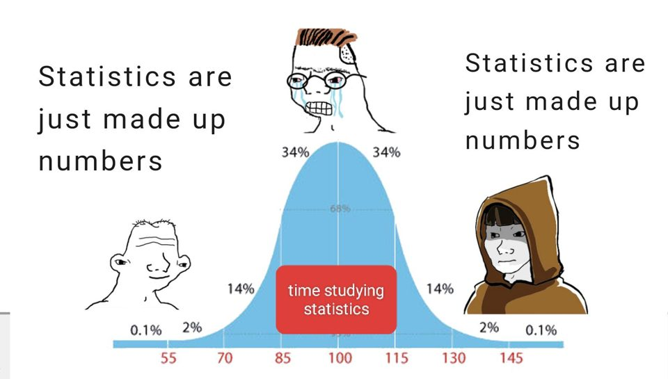

*Statistical Inference* by George Casella and Roger L. Berger is a book I had been trying to read for a year, but there were always other priorities. When I finally had the time, I crashed against a wall of statistical theory: some problems are fun, while others are a nightmare. Don't get me wrong, it's a very comprehensive book about statistics in general, but sometimes it can be a little bit too heavy. Still, if you've ever fit a regression, read a p-value or built a confidence interval, this is the book that explains why those things work, and when they don't.

I read it with a pen in hand and wrote a one-page summary of every chapter. This series is those notes, cleaned up and with the gaps filled in from the book. It's a pity that I couldn't include the mental struggle I had while writing those summaries.

{fig-alt="Bell curve meme about time spent studying statistics. The simple guy on the left and the hooded master on the right both say: statistics are just made up numbers. The crying nerd in the middle has no caption." width="560"}

## About the book

- **Authors:** George Casella and Roger L. Berger.
- **Edition:** 2nd edition (2002), the one these notes follow.
- **Level:** first-year graduate. It's the standard theory text in a lot of statistics master's and PhD programs, so don't feel bad if it takes you a while.
- **What you need:** calculus (including multivariable integrals and series) and some comfort reading proofs.
- **What it's not:** a book about software, computing or machine learning.

## The big picture

The whole book keeps coming back to one idea: we have data that come from a distribution with an unknown parameter $\theta$, and we want to learn something about $\theta$.

**Probability** (1–4) → **from population to sample** (5) → **reducing the data** (6) → **estimating** (7) → **testing** (8) → **intervals** (9) → **large samples** (10) → **models** (11–12)

- **Chapters 1–4** cover probability, random variables and the common distributions.
- **Chapter 5** covers the sample mean, the CLT, and the t and F distributions.
- **Chapter 6** asks which part of the data is the most important.
- **Chapters 7–9** are the heart of the book, the three ways of answering a question about $\theta$: give one number (point estimation), make a yes/no decision (hypothesis testing), or give a range (interval estimation).
- **Chapter 10** shows what we can still say when exact answers are impossible but $n$ is large.
- **Chapters 11–12** apply everything to ANOVA and regression models.

## Five ideas that run through the whole book

If you only keep five things from the book, keep these:

1.  **The likelihood is the center of everything.** The MLE, likelihood ratio tests, the Fisher information and the Bayesian posterior are all built on it. (Chapters 6–10)
2.  **You can compress the data without losing anything.** A sufficient statistic keeps all the information about $\theta$, and the best estimators and tests only depend on it. (Chapters 6–8)
3.  **Unbiased isn't always better.** Estimators trade bias against variance, and what matters is the total error. (Chapter 7)
4.  **A 95% confidence interval is a property of the method, not of your interval.** The 95% is how often the procedure captures $\theta$. The Bayesian credible interval is the one that talks about $\theta$ given your data. (Chapter 9)
5.  **With enough data, almost everything is normal.** The CLT, Slutsky and the delta method are basically why z-scores, Wald intervals and chi-squared tests work in practice. (Chapters 5 and 10)

## The series

1.  [**Part 1: Foundations**](../statistical-inference-part-1-foundations/index.qmd) (chapters 1–4). Sets and counting, probability, the common distributions, and multiple random variables.
2.  **Part 2: From Sample to Estimate** (chapters 5–7, coming 2 November). Random samples and the CLT, sufficiency, and how to find and evaluate estimators.
3.  **Part 3: Testing and Intervals** (chapters 8–9, coming 9 November). Hypothesis tests, p-values and confidence intervals.
4.  **Part 4: Large Samples and Models** (chapters 10–12, coming 16 November). Asymptotics, the bootstrap, ANOVA, and linear, logistic and robust regression.

When the four parts are out, the summary will also be on a single page, for when you (or I) just need to look something up.

## How to read it

It's something like half reference sheet, half guide. Every chapter:

- opens with the **main question** it answers,
- gives the key definitions and formulas, each one with a few lines on what it actually means,
- and ends with what it **builds on**, where it's **used later**, and the link to the next chapter.

You can use it on its own to refresh a topic, or read it alongside the book. The notation is explained at the start of Part 1. Please leave some feedback in the comments so I can improve the way I draft these summaries.

Miguel