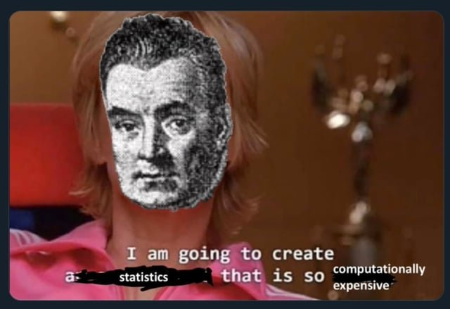
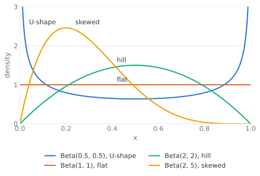
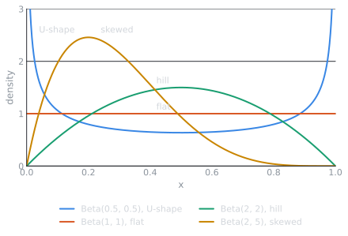
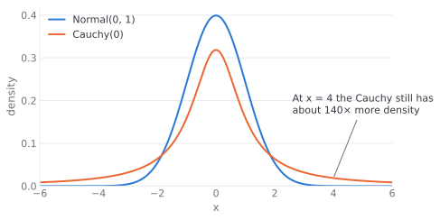
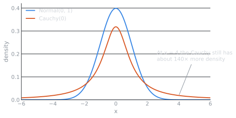
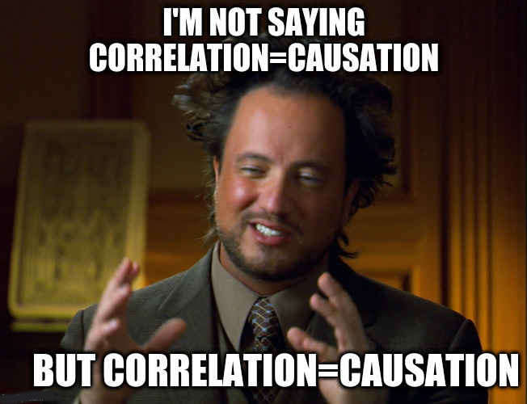
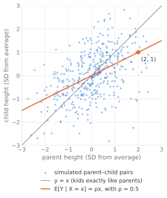
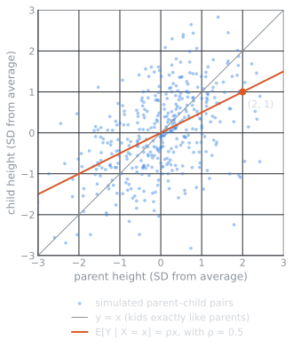

Part 1 of 4 of my summary of *Statistical Inference* by George Casella and Roger L. Berger (2nd edition). It covers chapters 1–4, the probability foundations that everything else is built on. For the big picture and how the series works, start with the [intro page](../statistical-inference-intro/index.qmd).

**Where we are:** **Probability (1–4)** → from population to sample (5) → reducing the data (6) → estimating (7) → testing (8) → intervals (9) → large samples (10) → models (11–12)

## Notation

- $X$ is a random variable and $x$ its observed value. A sample is $\mathbf{X} = (X_1, \ldots, X_n)$ and the observed data are $\mathbf{x} = (x_1, \ldots, x_n)$.
- $\theta$ is the parameter (it can be a vector) and $\Theta$ is the parameter space.
- $f(x \mid \theta)$ is the pdf or pmf, and $F(x)$ the CDF.
- $\xrightarrow{d}$ means convergence in distribution.
- Critical values are upper-tail: $z_{\alpha}$ leaves probability $\alpha$ to its right, so $z_{0.025} = 1.96$. Same for $t_{\nu,\alpha}$, $\chi^2_{\nu,\alpha}$ and $F_{\nu_1,\nu_2,\alpha}$.
- Where my parameterization differs from the book, I say so. E.g. my negative binomial counts trials, the book's counts failures.

------------------------------------------------------------------------

## 1. Set Theory and Counting

*Main question: before computing any probability, how do we describe everything that can happen, and how do we count it?*

This chapter is the warm-up. There's no statistics yet, just the vocabulary for "what can happen" and the tools to count it.

This is, of course, the introduction to the rest of the book, so it starts fairly easy. I didn't have much trouble with this one; I even thought about coding it, an idea I dropped pretty quickly in the following chapters.

### Sample space and events

The set of all possible outcomes of an experiment is the **sample space**, $S$. Roll a die and $S = \lbrace 1, 2, 3, 4, 5, 6 \rbrace$. An **event** is any subset of $S$, like "the roll is even", $\lbrace 2, 4, 6 \rbrace$.

Two events are **disjoint** (mutually exclusive) if they can't happen at the same time, $A \cap B = \varnothing$. Rolling a 1 and rolling an even number are disjoint.

**Sigma algebra.** It's the collection of events you are allowed to measure, i.e. assign a probability to. Casella & Berger also call it a *Borel field*, $\mathcal{B}$. It has to contain $\varnothing$, and it has to be closed under complements and countable unions, so that we never get an event we can't measure.

In human words: it's the list of questions you're allowed to ask about the experiment. If you can ask "did $A$ happen?", you can also ask "did $A$ not happen?" and "did $A$ or $B$ happen?", and the answer always has a probability.

If $S$ is finite with $n$ elements, we can just take all its subsets, $2^n$ of them. For $S = \lbrace 1, 2, 3 \rbrace$:

$$
\mathcal{B} = \big\lbrace \varnothing, \lbrace 1 \rbrace, \lbrace 2 \rbrace, \lbrace 3 \rbrace, \lbrace 1, 2 \rbrace, \lbrace 1, 3 \rbrace, \lbrace 2, 3 \rbrace, \lbrace 1, 2, 3 \rbrace \big\rbrace
$$

For $S = \mathbb{R}$ we can't measure every possible subset, so we use the smallest σ-algebra that contains all the intervals.

{fig-alt="The GigaChad meme: a black-and-white photo of a smiling, bearded, very muscular man." width="220"}

### Counting

When all outcomes are equally likely, probability is just counting: $P(A) = \lvert A \rvert / \lvert S \rvert$. So we need to know in how many ways we can choose $r$ objects from $n$. It depends on two things: does the order matter, and can we repeat?

|               | Without replacement | With replacement   |
|---------------|---------------------|--------------------|
| **Ordered**   | $\frac{n!}{(n-r)!}$ | $n^r$              |
| **Unordered** | $\binom{n}{r}$      | $\binom{n+r-1}{r}$ |

Everything here is built from the **factorial**, the number of ways to arrange $n$ things in a row: $n! = n \times (n-1) \times \cdots \times 1$.

**Permutations** (order matters, no repetition):

$$
P(n, r) = \frac{n!}{(n-r)!}
$$

**Combinations** (order doesn't matter, no repetition), the number of ways to choose $r$ elements from $n$:

$$
\binom{n}{r} = \frac{n!}{r!\,(n-r)!}
$$

**Stars and bars** (order doesn't matter, with repetition). Dividing $n$ identical things into $k$ groups: picture the $n$ things as stars and put $k - 1$ bars between them to separate the groups. You only choose where the bars go:

$$
\binom{n + k - 1}{k - 1}
$$

E.g. 3 identical cookies for 2 kids: $\binom{4}{1} = 4$ ways (3–0, 2–1, 1–2 and 0–3).

It's the bottom-right cell of the table with the names changed: choosing $r$ items from $n$ types with repetition is the same as dividing $r$ identical things into $n$ groups.

::: {.callout-note collapse="true"}
## Going further: balls into boxes

How many ways can you distribute $n$ balls among $r$ boxes?

| Balls          | Boxes          | Number of ways                |
|----------------|----------------|-------------------------------|
| $n$ distinct   | $r$ distinct   | $r^n$                         |
| $n$ indistinct | $r$ distinct   | $\binom{r+n-1}{n}$            |
| $n$ distinct   | $r$ indistinct | $\sum_{k=0}^{r} {n \brace k}$ |
| $n$ indistinct | $r$ indistinct | $p_r(n + r)$                  |

- ${n \brace k}$ are the **Stirling numbers of the second kind**: they count all the partitions of $n$ elements into $k$ non-empty groups.
- $p_r(n + r)$ is the number of partitions of $n + r$ into exactly $r$ parts, which is the same as the number of ways to write $n$ as a sum of at most $r$ positive integers, ignoring order. E.g. for $n = 4$ and $r \ge 4$: $4,\ 3+1,\ 2+2,\ 2+1+1,\ 1+1+1+1$.
:::

::: {.callout-note collapse="true"}
## Going further: a useful identity

$$
\sum_{k=0}^{n} \binom{n}{k}^2 = \binom{2n}{n}
$$

Why? Choose $n$ people from a group of $n$ men and $n$ women. Splitting by the number $k$ of men chosen, there are $\binom{n}{k}\binom{n}{n-k} = \binom{n}{k}^2$ ways for each $k$. Adding over all $k$ gives every possible group, which is $\binom{2n}{n}$.
:::

------------------------------------------------------------------------

**Builds on:** nothing, this is the start · **Used in:** ch. 2 (equally likely outcomes), ch. 3 (the coefficients of the binomial and hypergeometric)

*Next: now we know what can happen and how to count it. How do we put probabilities on it?*

------------------------------------------------------------------------

## 2. Probability Theory

*Main question: how do we assign probabilities to events, and how do we turn outcomes into numbers we can work with?*

This chapter is probably the base for the rest of the book, so it's worth understanding it deeply.

### Axioms

Given a sample space $S$ and a σ-algebra $\mathcal{B}$, a **probability function** is a function $P$ with domain $\mathcal{B}$ that satisfies:

1.  $P(A) \ge 0$ for all $A \in \mathcal{B}$.
2.  $P(S) = 1$.
3.  If $A_1, A_2, \ldots \in \mathcal{B}$ are pairwise disjoint, then $P\left(\bigcup_{i=1}^{\infty} A_i\right) = \sum_{i=1}^{\infty} P(A_i)$.

The domain being $\mathcal{B}$ means we only work with sets that are inside the σ-algebra. Axiom 3 says that if the events don't overlap, the probability of any of them happening is the sum.

Everything else follows from these three. For example, **Boole's inequality**: the probability that at least one of several events happens is at most the sum of their probabilities.

$$
P\left(\bigcup_{i=1}^{n} A_i\right) \le \sum_{i=1}^{n} P(A_i)
$$

Boole overcounts when the events overlap, because the overlaps get added more than once. **Bonferroni's inequality** fixes that from the other side, a lower bound that subtracts the overlaps, so the real probability sits between the two:

$$
P\left(\bigcup_{i=1}^{n} A_i\right) \ge \sum_{i=1}^{n} P(A_i) - \sum_{1 \le i < j \le n} P(A_i \cap A_j)
$$

### Conditional probability, Bayes' rule and independence

$$
P(A \mid B) = \frac{P(A \cap B)}{P(B)}, \qquad P(B) > 0
$$

The probability of $A$ once we know $B$ happened. Basically $B$ becomes the new sample space.

**Bayes' rule** flips the conditioning. If $A_1, A_2, \ldots$ is a partition of $S$:

$$
P(A_i \mid B) = \frac{P(B \mid A_i)\, P(A_i)}{\sum_j P(B \mid A_j)\, P(A_j)}
$$

This is exactly the update from prior to posterior that we use in chapter 7.

In the context of the book, I didn't find Bayes that important for the main narrative, but I find it interesting given the advances in Bayesian inference, especially in marketing (which is what I do for work!).

{fig-alt="Mean Girls meme with the face of Thomas Bayes pasted on, and the subtitle: I am going to create a statistics that is so computationally expensive." width="420"}

$A$ and $B$ are **independent** if

$$
P(A \cap B) = P(A)\, P(B)
$$

which is the same as saying $P(A \mid B) = P(A)$: knowing $B$ doesn't change anything about $A$.

### Random variables

A function from the sample space into the real numbers. In other words, a rule that assigns a number to each outcome of the experiment, e.g. the value of a die roll.

**Cumulative distribution function (CDF).** A "running total" of probability as you move along. At each point $x$ it tells you how much probability has accumulated up to that point:

$$
F_X(x) = P(X \le x), \qquad x \in \mathbb{R}
$$

**Probability mass function (PMF).** Only for discrete random variables. It's a table of exact probabilities:

$$
f_X(x) = P(X = x)
$$

**Probability density function (PDF).** Only for continuous random variables. Probabilities are areas under the curve:

$$
P(a \le X \le b) = \int_a^b f_X(x)\,dx, \qquad f_X(x) \ge 0, \qquad \int_{-\infty}^{\infty} f_X(x)\,dx = 1
$$

The PDF is not a probability itself, and $P(X = x) = 0$ for any particular value. You only get probabilities when you integrate.

### Functions of a random variable

Any function of $X$ is a random variable as well, $Y = g(X)$, and to describe $Y$ we go back to $X$:

$$
P(Y \in A) = P\big(g(X) \in A\big)
$$

using the **inverse mapping** $g^{-1}(y) = \lbrace x : g(x) = y \rbrace$, the set of all values of $x$ that get mapped to $y$. Remember that $g$ can map several values of $x$ to the same $y$.

**Discrete:** add up everything that lands on $y$. If $g$ is one-to-one, it's just $f_X\big(g^{-1}(y)\big)$.

$$
f_Y(y) = \sum_{x \in g^{-1}(y)} f_X(x)
$$

**Continuous, monotone** $g$:

$$
f_Y(y) = f_X\big(g^{-1}(y)\big)\left\lvert \frac{d}{dy}\, g^{-1}(y) \right\rvert = \frac{f_X\big(g^{-1}(y)\big)}{\big\lvert g'\big(g^{-1}(y)\big) \big\rvert}
$$

The derivative term is necessary so that everything still integrates to 1: if $g$ stretches the axis, the density has to get thinner. E.g. if $X \sim \text{Uniform}(0, 1)$ and $Y = 2X$, the same probability now spreads over $(0, 2)$, so the height drops from 1 to $1/2$.

**Many-to-one** $g$: add up the pieces.

$$
f_Y(y) = \sum_{x_i \in g^{-1}(y)} \frac{f_X(x_i)}{\lvert g'(x_i) \rvert}
$$

### Expected value and moments

$$
E\,g(X) = \begin{cases} \displaystyle\int_{-\infty}^{\infty} g(x)\, f_X(x)\,dx & \text{if } X \text{ is continuous} \\ \displaystyle\sum_{x} g(x)\, f_X(x) & \text{if } X \text{ is discrete} \end{cases}
$$

It is the mean, in probability theory: the long-run average you would get if you repeated the experiment over and over. Each value is weighted by how likely it is. It's linear, $E(aX + b) = a\,E X + b$.

So what is a moment, really? A distribution is a whole curve, which is a lot to carry around. Moments summarize it with a few numbers, and each one answers a simple question about its shape: where is it centered? How spread out is it? Is it lopsided? How often does it throw extreme values? Basically, you raise $X$ to a power and take the average. The higher the power, the more weight the values far from the center get, so the higher moments are mostly about the tails. The name comes from physics: the mean is the center of mass of the distribution, and the variance works like its moment of inertia.

Formally, **moments** describe the shape of the distribution. The moment of order $n$ is $\mu_n' = E X^n$, and the **central moments** are expectations of powers of the deviation from the mean:

$$
\mu_k = E\big[(X - E X)^k\big]
$$

1.  1st central moment $= 0$ (the mean itself, $E X$, tells you where it's centered)
2.  2nd central moment = variance, $\sigma^2$: how spread out it is
3.  3rd central moment → skewness, $\alpha_3 = \mu_3 / \sigma^3$: how asymmetric
4.  4th central moment → kurtosis, $\alpha_4 = \mu_4 / \sigma^4$: how heavy the tails are

Two variance shortcuts that are used everywhere:

$$
\operatorname{Var} X = E X^2 - (E X)^2, \qquad \operatorname{Var}(aX + b) = a^2 \operatorname{Var} X
$$

### Moment generating function (MGF)

$$
M_X(t) = E\, e^{tX}
$$

A function that packs all the moments in one place. Why $e^{tX}$? Because its Taylor series is $1 + tX + t^2 X^2 / 2! + \cdots$, so taking the expectation stores $E X$, $E X^2$, $E X^3$, and so on as coefficients, like a zip file of the moments. To unzip moment $n$, differentiate $n$ times and evaluate at 0:

$$
E X^n = \frac{d^n}{dt^n} M_X(t)\Big\vert_{t=0}
$$

More important than the moments: if two MGFs exist and are equal around $t = 0$, the two distributions are the same. Think of the MGF as the fingerprint of a distribution. That's the trick behind the CLT in chapter 5.

------------------------------------------------------------------------

**Builds on:** ch. 1 · **Used in:** ch. 3 (every distribution is a pmf or pdf with its moments), ch. 4 (several variables at once), ch. 7 (Bayes' rule for posteriors)

*Next: we have the general tools. Which distributions actually show up in practice?*

------------------------------------------------------------------------

## 3. Distributions

*Main question: which distributions show up again and again, and what kind of data does each one model?*

This chapter is basically a catalog. For each distribution: what it models and its pmf or pdf. Means and variances are all together in the summary table at the end.

In my opinion, you don't need to memorize every distribution, but you do need to be familiar with them: at least understand how each one works and what it looks like. Keep in mind that these are descriptions I wrote for my own use.

{fig-alt="A red Pokédex lying open on a wooden table, next to two Poké Balls." width="420"}

### Discrete

**Discrete uniform** $(1, N)$. Puts equal mass on each of the outcomes.

$$
P(X = x \mid N) = \frac{1}{N}, \qquad x = 1, \ldots, N
$$

**Bernoulli** $(p)$. One trial: success (1) with probability $p$, failure (0) with probability $1 - p$.

**Binomial** $(n, p)$. Number of successes in $n$ independent Bernoulli trials. One particular sequence with $y$ successes has probability $p^y (1-p)^{n-y}$, and there are $\binom{n}{y}$ of them:

$$
P(Y = y) = \binom{n}{y} p^y (1-p)^{n-y}, \qquad y = 0, 1, \ldots, n
$$

**Hypergeometric** $(N, M, K)$. Similar to the binomial, but without replacement from a finite population: $N$ items, $M$ of them successes, and we draw $K$. Since nothing is replaced, the probability changes after each draw.

$$
P(X = x \mid N, M, K) = \frac{\binom{M}{x}\binom{N-M}{K-x}}{\binom{N}{K}}
$$

It helps, for example, with the minimum acceptance criteria for products: you test 10 products from a lot and none of them is bad. How likely is that if the lot actually has 6 bad ones?

**Poisson** $(\lambda)$. Number of times an event occurs in a fixed interval, when events are independent and happen at a constant average rate.

$$
P(X = x \mid \lambda) = \frac{e^{-\lambda}\lambda^x}{x!}, \qquad x = 0, 1, 2, \ldots
$$

**Negative binomial** $(r, p)$. Number of trials needed to get $r$ successes. The book counts the failures instead, $Y = X - r$.

$$
P(X = x \mid r, p) = \binom{x-1}{r-1} p^r (1-p)^{x-r}, \qquad x = r, r+1, \ldots
$$

**Geometric** $(p)$. The negative binomial with $r = 1$: number of trials until the first success.

$$
P(X = x \mid p) = (1-p)^{x-1} p, \qquad x = 1, 2, \ldots
$$

It's **memoryless**: $P(X > s + t \mid X > s) = P(X > t)$. If you've already failed $s$ times, the wait ahead looks exactly like starting from zero.

### Continuous

**Uniform** $(a, b)$.

$$
f(x \mid a, b) = \frac{1}{b - a}, \qquad a \le x \le b
$$

**Exponential** $(\beta)$. Waiting time until the first event in a Poisson process, with mean waiting time $\beta$. The continuous version of the geometric, memoryless too.

$$
f(x \mid \beta) = \frac{1}{\beta}\, e^{-x/\beta}, \qquad x > 0
$$

**Gamma** $(\alpha, \beta)$. Waiting time until $\alpha$ events, for integer $\alpha$. The exponential is the case $\alpha = 1$.

$$
f(x \mid \alpha, \beta) = \frac{1}{\Gamma(\alpha)\,\beta^\alpha}\, x^{\alpha-1} e^{-x/\beta}, \qquad x > 0
$$

where $\Gamma(\alpha) = (\alpha - 1)!$ when $\alpha$ is an integer. $\alpha$ is the shape (number of occurrences) and $\beta$ the scale (average time between occurrences). It's related to the Poisson: the Poisson tells you how many events happen in a time $t$, and the gamma tells you how long until $\alpha$ events.

**Normal** $(\mu, \sigma^2)$.

$$
f(x \mid \mu, \sigma^2) = \frac{1}{\sqrt{2\pi}\,\sigma}\, e^{-(x-\mu)^2/(2\sigma^2)}, \qquad -\infty < x < \infty
$$

**Beta** $(\alpha, \beta)$. Lives on $(0, 1)$, so it's the natural model for probabilities and proportions (we use it as a prior in chapter 7). Basically you can get almost any shape between 0 and 1 by changing $\alpha$ and $\beta$, but not a bimodal one: the closest it gets is a U-shape, with the mass piled up at both ends.

$$
f(x \mid \alpha, \beta) = \frac{1}{B(\alpha, \beta)}\, x^{\alpha-1}(1-x)^{\beta-1}, \qquad B(\alpha, \beta) = \frac{\Gamma(\alpha)\,\Gamma(\beta)}{\Gamma(\alpha + \beta)}
$$

::: {.light-content}
{fig-alt="Density curves of Beta(0.5, 0.5), U-shaped; Beta(1, 1), flat; Beta(2, 2), a symmetric hill; and Beta(2, 5), skewed to the right."}
:::

::: {.dark-content}
{fig-alt="Density curves of Beta(0.5, 0.5), U-shaped; Beta(1, 1), flat; Beta(2, 2), a symmetric hill; and Beta(2, 5), skewed to the right."}
:::

**Cauchy** $(\theta)$. It looks like the normal, but the tails are so fat that the mean doesn't exist: $E\lvert X \rvert = \infty$. You can't cancel infinity with infinity.

$$
f(x \mid \theta) = \frac{1}{\pi}\,\frac{1}{1 + (x - \theta)^2}, \qquad -\infty < x < \infty
$$

::: {.light-content}
{fig-alt="Density curves of the standard normal and the Cauchy between -6 and 6. The Cauchy has a lower peak and much fatter tails: at x = 4 it has about 140 times more density than the normal."}
:::

::: {.dark-content}
{fig-alt="Density curves of the standard normal and the Cauchy between -6 and 6. The Cauchy has a lower peak and much fatter tails: at x = 4 it has about 140 times more density than the normal."}
:::

**Lognormal** $(\mu, \sigma^2)$. $X$ is not normal, but $\log X$ is. Useful for positive variables skewed to the right.

$$
f(x \mid \mu, \sigma^2) = \frac{1}{\sqrt{2\pi}\,\sigma}\,\frac{1}{x}\, e^{-(\log x - \mu)^2/(2\sigma^2)}, \qquad x > 0
$$

**Double exponential (Laplace)** $(\mu, \sigma)$. Two exponentials back to back: a sharp peak at $\mu$, with $\sigma$ controlling the spread.

$$
f(x \mid \mu, \sigma) = \frac{1}{2\sigma}\, e^{-\lvert x - \mu \rvert/\sigma}, \qquad -\infty < x < \infty
$$

### Approximations

- If $n$ is large and $p$ is not close to 0 or 1, $\text{Binomial}(n, p) \approx N\big(np,\ np(1-p)\big)$.
- If $n$ is large and $p$ is small, $\text{Binomial}(n, p) \approx \text{Poisson}(np)$.

### Summary table

| Distribution | Support | Mean | Variance |
|------------------|------------------|------------------|------------------|
| Discrete uniform $(1, N)$ | $1, \ldots, N$ | $\frac{N+1}{2}$ | $\frac{(N+1)(N-1)}{12}$ |
| Bernoulli $(p)$ | $0, 1$ | $p$ | $p(1-p)$ |
| Binomial $(n, p)$ | $0, \ldots, n$ | $np$ | $np(1-p)$ |
| Hypergeometric $(N, M, K)$ | $0, \ldots, K$ | $\frac{KM}{N}$ | $\frac{KM}{N}\,\frac{(N-M)(N-K)}{N(N-1)}$ |
| Poisson $(\lambda)$ | $0, 1, 2, \ldots$ | $\lambda$ | $\lambda$ |
| Negative binomial $(r, p)$, trials | $r, r+1, \ldots$ | $\frac{r}{p}$ | $\frac{r(1-p)}{p^2}$ |
| Geometric $(p)$ | $1, 2, \ldots$ | $\frac{1}{p}$ | $\frac{1-p}{p^2}$ |
| Uniform $(a, b)$ | $[a, b]$ | $\frac{a+b}{2}$ | $\frac{(b-a)^2}{12}$ |
| Exponential $(\beta)$ | $(0, \infty)$ | $\beta$ | $\beta^2$ |
| Gamma $(\alpha, \beta)$ | $(0, \infty)$ | $\alpha\beta$ | $\alpha\beta^2$ |
| Normal $(\mu, \sigma^2)$ | $\mathbb{R}$ | $\mu$ | $\sigma^2$ |
| Beta $(\alpha, \beta)$ | $(0, 1)$ | $\frac{\alpha}{\alpha+\beta}$ | $\frac{\alpha\beta}{(\alpha+\beta)^2(\alpha+\beta+1)}$ |
| Cauchy $(\theta)$ | $\mathbb{R}$ | doesn't exist | doesn't exist |
| Lognormal $(\mu, \sigma^2)$ | $(0, \infty)$ | $e^{\mu + \sigma^2/2}$ | $e^{2(\mu + \sigma^2)} - e^{2\mu + \sigma^2}$ |
| Laplace $(\mu, \sigma)$ | $\mathbb{R}$ | $\mu$ | $2\sigma^2$ |

The hypergeometric support is really $\max(0, K - N + M) \le x \le \min(M, K)$, but $0, \ldots, K$ is the idea.

{fig-alt="The Surprised Pikachu meme: Pikachu with its mouth open in shock." width="320"}

### Exponential families

A lot of famous distributions look different on paper but share the same skeleton: a part that depends only on $x$, times an exponential where $x$ and $\theta$ meet only through $t(x) \cdot \theta$, divided by a constant that makes everything add up to 1. Why care? Because once a distribution fits this mold, a lot of results come for free: the sufficient statistic, the mean and variance from derivatives, and nice estimators and tests later on.

Formally, we can represent a lot of distributions using the exponential form:

$$
p(x \mid \theta) = \frac{1}{Z(\theta)}\, h(x) \exp\big(t(x) \cdot \theta\big)
$$

- $h(x)$: the "volume" of $x$, a probabilistic volume intrinsic to $x$ (normally 1).
- $t(x)$: the sufficient statistic, a vector that measures everything within $x$ that matters for determining probabilities via $\theta$ (chapter 6 explains why it's called that).
- $Z(\theta)$: makes all the probability sum (integrate) to 1, $Z(\theta) = \int h(x) \exp\big(t(x) \cdot \theta\big)\, \nu(dx)$, where $\nu(dx)$ tells us whether we are integrating over a continuous or a discrete domain.

The normal, binomial, Poisson, gamma and beta are all exponential families. The Cauchy and the $\text{Uniform}(0, \theta)$ are not; the uniform fails because its support depends on $\theta$.

::: {.callout-note collapse="true"}
## Going further: mean and variance for free

The nice part is that the mean and variance of $t(X)$ come straight from derivatives of $\log Z$:

$$
E[t(X) \mid \theta] = \nabla_\theta \log Z(\theta), \qquad \operatorname{Var}[t(X) \mid \theta] = \nabla_\theta^2 \log Z(\theta)
$$

the gradient and the Hessian.
:::

### Location–scale families

- $\mu$ = location parameter (moves the distribution)
- $\sigma$ = scale parameter (stretches it)
- $\alpha$ = shape parameter (changes the shape itself)

A location–scale family is all the distributions you get from a "standard form" $f_0$ by shifting and stretching:

$$
Y = \mu + \sigma X, \qquad f_Y(y) = \frac{1}{\sigma}\, f_0\!\left(\frac{y - \mu}{\sigma}\right)
$$

where $X$ follows $f_0$. So the mean and variance change, but the shape doesn't:

$$
E[Y] = \mu + \sigma E[X], \qquad \operatorname{Var}[Y] = \sigma^2 \operatorname{Var}[X]
$$

$$
\operatorname{Skew}[Y] = \operatorname{Skew}[X], \qquad \operatorname{Kurt}[Y] = \operatorname{Kurt}[X]
$$

This is important for parameter estimation: anything that removes location and scale (chapter 6) doesn't depend on $\mu$ and $\sigma$.

------------------------------------------------------------------------

**Builds on:** ch. 2 · **Used in:** ch. 5 (sampling from the normal), ch. 6 (exponential families and sufficiency), ch. 7–12 (these are the models we estimate and test)

*Next: one random variable at a time isn't enough, because a sample is many variables together. How do we describe them jointly?*

------------------------------------------------------------------------

## 4. Multiple Random Variables

*Main question: how do we describe several random variables at once, and how do they depend on each other?*

### Joint, marginal and conditional distributions

**Joint distribution.** It describes how two or more variables vary together. It's like a 2D map of probabilities:

$$
F_{X,Y}(x, y) = P(X \le x,\ Y \le y)
$$

**Marginal distribution.** Sum (or integrate) the other variable out. You don't care about $Y$, you just care about $X$:

$$
f_X(x) = \sum_y f_{X,Y}(x, y) \qquad \text{or} \qquad f_X(x) = \int_{-\infty}^{\infty} f_{X,Y}(x, y)\,dy
$$

**Conditional distribution.** What is the distribution of $X$ if I already know $Y = y$?

$$
f_{X \mid Y}(x \mid y) = \frac{f_{X,Y}(x, y)}{f_Y(y)}
$$

The joint divided by the marginal: adding up the joint over all $x$ gives $f_Y(y)$, so dividing by it makes the conditional sum to 1.

**Independence.** $X$ and $Y$ are independent if

$$
f_{X,Y}(x, y) = f_X(x)\, f_Y(y) \quad \text{for all } x, y
$$

Then knowing $Y$ tells you nothing about $X$, and expectations of products split: $E\big[g(X)\,h(Y)\big] = E\,g(X)\; E\,h(Y)$. That's why sums of independent variables are easy with MGFs:

$$
M_{X+Y}(t) = M_X(t)\, M_Y(t)
$$

### Transformations of several variables

Same idea as in chapter 2, but the derivative becomes a Jacobian. It plays the same role: it measures how much the transformation stretches or squeezes a small area, and the density has to compensate so the total stays 1. If $(U, V)$ is a one-to-one transformation of $(X, Y)$ with inverse $x = h_1(u, v)$ and $y = h_2(u, v)$:

$$
f_{U,V}(u, v) = f_{X,Y}\big(h_1(u, v), h_2(u, v)\big)\, \lvert J \rvert, \qquad J = \det\begin{pmatrix} \partial x / \partial u & \partial x / \partial v \\ \partial y / \partial u & \partial y / \partial v \end{pmatrix}
$$

### Conditional expectation

$$
E[X \mid Y = y] = \sum_x x\, f_{X \mid Y}(x \mid y) \qquad \text{or} \qquad \int_{-\infty}^{\infty} x\, f_{X \mid Y}(x \mid y)\,dx
$$

It's basically the same as the expected value, but just for one specific value of $Y$. Realize that $E(X \mid Y)$, as a function of $Y$, is itself a random variable, and two very useful identities come out of that:

$$
E X = E\big[E(X \mid Y)\big]
$$

$$
\operatorname{Var} X = E\big[\operatorname{Var}(X \mid Y)\big] + \operatorname{Var}\big(E(X \mid Y)\big)
$$

The first one says that the expectation of the conditional expectation gives back the mean. The second one splits the variance into the noise within each value of $Y$ plus the variation between the conditional means. It's the same split that ANOVA uses in chapter 11. E.g. the variance of people's heights is the average variance of heights within each country, plus how much the country averages differ from each other.

They are the key to **hierarchical models**. E.g. an insect lays $Y \sim \text{Poisson}(\lambda)$ eggs and each one survives with probability $p$, so $X \mid Y \sim \text{Binomial}(Y, p)$. Without computing the distribution of $X$:

$$
E X = E\big[E(X \mid Y)\big] = E[pY] = p\lambda
$$

### Covariance and correlation

Covariance asks a simple question: when $X$ is above its mean, does $Y$ tend to be above its mean too? Positive if they move together, negative if they move in opposite directions. Correlation is the same thing rescaled, so the units don't matter and it always lands between $-1$ and $1$.

With $E X = \mu_X$, $E Y = \mu_Y$, $\operatorname{Var} X = \sigma_X^2$ and $\operatorname{Var} Y = \sigma_Y^2$:

$$
\operatorname{Cov}(X, Y) = E\big[(X - \mu_X)(Y - \mu_Y)\big], \qquad \rho_{XY} = \frac{\operatorname{Cov}(X, Y)}{\sigma_X\, \sigma_Y}
$$

$$
\operatorname{Var}(X + Y) = \operatorname{Var} X + \operatorname{Var} Y + 2\operatorname{Cov}(X, Y)
$$

The correlation is always between $-1$ and $1$, and $\lvert \rho \rvert = 1$ only if $Y = aX + b$. But careful: it only measures *linear* dependence. Independent means $\rho = 0$, but $\rho = 0$ doesn't mean independent. E.g. $X \sim N(0, 1)$ and $Y = X^2$ have $\rho = 0$, and $Y$ is completely determined by $X$.

{fig-alt="The Ancient Aliens meme: a man gesturing, with the text: I'm not saying correlation = causation, but correlation = causation." width="360"}

### Bivariate normal

$(X, Y)$ is bivariate normal with means $\mu_X, \mu_Y$, variances $\sigma_X^2, \sigma_Y^2$ and correlation $\rho$. Both marginals are normal, and so is the conditional:

$$
Y \mid X = x \sim N\left(\mu_Y + \rho\,\frac{\sigma_Y}{\sigma_X}(x - \mu_X),\ \ \sigma_Y^2(1 - \rho^2)\right)
$$

Picture a cloud of points shaped like an ellipse: $\rho$ tilts it and squeezes it. The conditional mean is a straight line in $x$, and this is where linear regression comes from (chapter 11). It also explains regression to the mean: since $\lvert \rho \rvert < 1$, if $X$ is far above average, $Y$ is expected to be above average too, but less extreme. Tall parents tend to have tall kids, just not as tall. Also, here (and not in general) $\rho = 0$ does mean independence.

::: {.light-content}
{fig-alt="Scatter plot of 400 simulated parent and child heights, in standard deviations from the average, with correlation 0.5. The line y = x is steeper than the conditional mean line y = 0.5x; the point (2, 1) is highlighted."}
:::

::: {.dark-content}
{fig-alt="Scatter plot of 400 simulated parent and child heights, in standard deviations from the average, with correlation 0.5. The line y = x is steeper than the conditional mean line y = 0.5x; the point (2, 1) is highlighted."}
:::

### Inequalities

**Chebyshev:** for any random variable with mean $\mu$ and variance $\sigma^2$,

$$
P\big(\lvert X - \mu \rvert \ge k\sigma\big) \le \frac{1}{k^2}
$$

It means at most $1/k^2$ of the probability can be more than $k$ standard deviations away from the mean. E.g. at least 75% of any distribution is within 2 standard deviations. Very rough, but it works for any distribution, and it's how the Weak Law of Large Numbers is proved in chapter 5.

**Cauchy–Schwarz:** $\lvert E XY \rvert \le \sqrt{E X^2 \; E Y^2}$. Applied to $X - \mu_X$ and $Y - \mu_Y$, it's why $\lvert \rho \rvert \le 1$.

**Jensen:** if $g$ is convex (curved upwards, like a bowl), $E\,g(X) \ge g(E X)$: averaging first and then applying $g$ gives less than applying $g$ first and then averaging. E.g. $E X^2 \ge (E X)^2$, which is just saying the variance can't be negative.

------------------------------------------------------------------------

**Builds on:** ch. 2, ch. 3 · **Used in:** ch. 5 (a sample is $n$ random variables), ch. 7 (Rao–Blackwell is a conditional expectation), ch. 11 (bivariate normal model and the variance split)

*Next: a random sample is a special case,* $n$ variables that are independent and all come from the same distribution. How do their mean and variance behave?
